# FraudStream

### Financial Fraud Detection & Risk Intelligence Platform

**Real-time fraud scoring for synthetic payment transactions. Events stream through Apache Kafka. Spark Structured
Streaming applies stateful feature engineering, machine-learning inference and an explainable risk engine. Analysts
then triage the resulting alerts in a React dashboard.**


> [!IMPORTANT]
> **Educational project, synthetic data only.** The built-in simulator generates every transaction, customer,
> merchant and location. Model metrics in this repository are measured on that **synthetic dataset**. They show that
> the pipeline learns the simulator's injected scenarios and **do not establish real-world fraud-detection
> performance**. Risk scores are model estimates, not determinations of fraud. Nothing real is ever blocked, because
> the `BLOCK_SIMULATION` action exists only inside the simulation. All performance figures come from **one development
> machine** and do not describe production capacity.

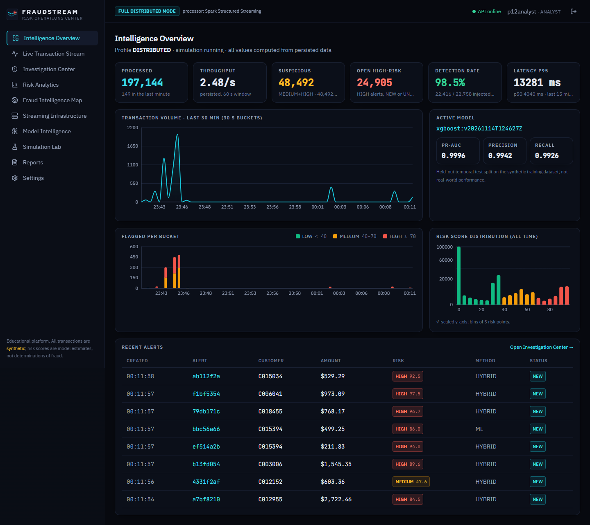

<sub>The Intelligence Overview in the distributed profile. The Playwright E2E suite captured it on an isolated test
stack right after the load and failure benchmarks, so the latency and flagged counts are higher than in a fresh run.
For details, see [Dashboard screenshots](#8-dashboard-screenshots).</sub>

---

## Contents

1. [Introduction](#1-introduction)
2. [Problem statement and motivation](#2-problem-statement-and-motivation)
3. [Key features](#3-key-features)
4. [System architecture](#4-system-architecture)
5. [Technology stack](#5-technology-stack)
6. [Installation and setup](#6-installation-and-setup)
7. [Execution modes: local and distributed](#7-execution-modes-local-and-distributed)
8. [Dashboard screenshots](#8-dashboard-screenshots)
9. [Machine learning methodology and evaluation](#9-machine-learning-methodology-and-evaluation)
10. [Streaming pipeline](#10-streaming-pipeline)
11. [API documentation](#11-api-documentation)
12. [Testing and verification](#12-testing-and-verification)
13. [Security considerations](#13-security-considerations)
14. [Known limitations](#14-known-limitations)
15. [Future improvements](#15-future-improvements)
16. [Documentation map](#16-documentation-map)
17. [License](#17-license)

---

## 1. Introduction

FraudStream is an end-to-end streaming machine-learning system built around a fraud-operations workflow:

1. A deterministic **transaction simulator** produces payment events, including seven labelled suspicious scenarios.
2. Events go through **Apache Kafka** to **Spark Structured Streaming**, which validates and deduplicates them, builds
   per-customer behavioural features, runs **ML inference** (XGBoost plus Isolation Forest) and applies a **rule-based
   risk engine**.
3. An idempotent persistence consumer writes each scored transaction, prediction and alert to **PostgreSQL**, and
   **Redis** pushes them to the dashboard live. Spark's Kafka output is at-least-once, so a replayed record can arrive
   twice. The consumer and the database's uniqueness constraints reject the repeat, leaving one row per event
   (see [Delivery semantics](#delivery-semantics)).
4. Analysts use a **React dashboard** served through a **FastAPI** backend to triage alerts, run investigations,
   inspect models and drift, analyse risk patterns and generate reports. Every action is audited.

The entire platform runs on one machine with Docker Compose. It is designed to be measured as well as run: it includes
latency and throughput benchmarks, failure-injection tests, a tested backup/restore cycle and a security review, all
with their raw results in the repository.

## 2. Problem statement and motivation

Card and account fraud has to be detected **while transactions are flowing**, not in a nightly batch. That raises
several engineering problems:

- **Stateful features over a live stream.** Useful signals depend on each customer's recent history: velocity,
  deviation from typical spend, new devices or locations, impossible travel and repeated failures. These have to be
  computed incrementally and survive restarts.
- **Combining models with explainable rules.** A supervised model, an anomaly detector and domain rules each catch
  different things. Analysts need one bounded score and a clear explanation of what drove it.
- **Correctness under failure.** A broker outage, processor crash or database restart must not lose or duplicate a
  scored transaction.
- **A human workflow.** Flagged transactions are only useful if analysts can review, investigate and close them with
  an audit trail.
- **Honest evaluation.** ML on time-ordered transaction data is easy to leak. Splits, thresholds and model selection
  must not see the test data.

FraudStream implements each of these on synthetic data. It exists to show the design and its trade-offs, with
measured evidence, rather than to claim fraud-detection performance.

**Intended audience:** students and engineers studying streaming ML systems, reviewers who want to see a complete
pipeline running end to end, and technical interviews or portfolio review. It is **not** a production fraud system.

## 3. Key features

| Area | What exists in the codebase |
|---|---|
| **Transaction simulation** | `simulator/generator.py`: seeded customer population, 38 public city centroids, 7 scenarios (`large_amount`, `velocity_burst`, `failed_attempts`, `account_takeover`, `impossible_travel`, `odd_hour`, `suspicious_merchant`). Simulation Lab page: start, pause and stop runs, inject a single scenario, save configurations, replay. |
| **Kafka ingestion** | 7 topics, idempotent producers (`acks=all`), and `POST /transactions/ingest` for single events. |
| **Spark Structured Streaming** | 6 queries: scoring, watermark deduplication, 2 tumbling and 2 sliding windows. RocksDB state store; checkpointed recovery. **Local mode (`local[8]`) in a single container.** |
| **Feature engineering** | 29 versioned features (`fc-1.0`): amount statistics, 1 m / 5 m / 1 h velocity, 15 m / 1 h spend, z-score, new device / location / merchant, geo-velocity, failure counts, time of day. |
| **ML fraud scoring** | Active models: XGBoost (supervised) and Isolation Forest (anomaly), loaded read-only from `ml/artifacts`. Per-prediction feature contributions (XGBoost TreeSHAP). |
| **Hybrid risk engine** | 10 configurable rules in 7 signal families, combined with the model and anomaly components by noisy-OR into a 0–100 score. LOW / MEDIUM / HIGH categories map to ALLOW / REVIEW / BLOCK_SIMULATION. |
| **Alerts and investigations** | Alerts for MEDIUM and HIGH risk; triage (status, assignment, notes); investigations that link alerts and record findings and a final classification; CSV export; per-alert audit history. |
| **Model Intelligence** | Registry with validation and test metrics, model comparison, live inference latency, PSI drift monitoring, and experiment and artifact inspection (SHA-256 of every file). |
| **Streaming Infrastructure** | Live health of PostgreSQL, Redis, Kafka, Spark and the consumer; per-query Spark progress and checkpoints; topic offsets, consumer-group lag and the dead-letter queue. |
| **Risk Analytics** | Scenario patterns (labelled versus flagged), confusion matrix against simulator labels, merchant categories, hourly distribution, velocity leaders. |
| **Fraud Intelligence Map** | Dependency-free SVG latitude/longitude plot of simulated city centroids (no basemap), with city and country tables. |
| **Reports** | 6 SQL-computed report types, stored as snapshots and exported as CSV (formula-injection guarded) or PDF. |
| **Settings and audit** | Admin-only rule, threshold and drift settings with validation, confirmation and optimistic concurrency. An append-only audit trail records logins, triage, configuration changes, and denied or rejected attempts. |
| **Operations** | Health checks, failure recovery procedures, and `scripts/backup.py` / `restore.py` / `verify_restore.py` with checksums and verification against the running stack. |

## 4. System architecture

The diagram shows the **distributed profile**, the full platform. Each box corresponds to code or a service in
`docker-compose.yml`.

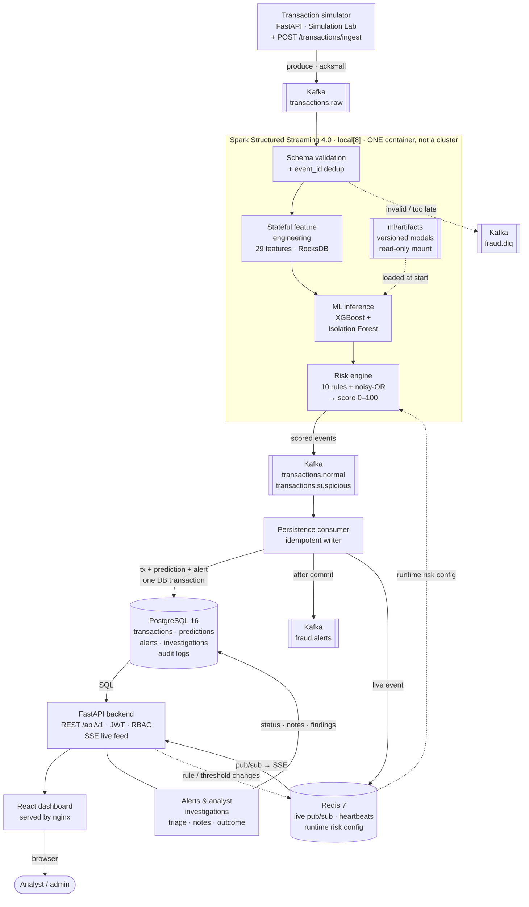

**Notes**

- **Spark runs in local mode** (`SPARK_MASTER=local[8]`, eight threads in one JVM) inside a **single container**.
  There is no Spark cluster, standalone master, YARN or Kubernetes. The same Structured Streaming code would run on a
  cluster, but that deployment has not been done.
- Kafka is a single broker (replication factor 1), with one PostgreSQL and one Redis instance. Everything runs on one
  Docker host, on a private bridge network with host ports bound to `127.0.0.1`. nginx is the only HTTP entry point.
- Not drawn: the window queries that write `features.windows` and `transactions.validated` (monitoring outputs), the
  one-shot `app-init` (migrations and accounts) and `kafka-init` (topics) containers, the Spark checkpoint volume,
  and the opt-in `python-processor` fallback.
- The **local profile** replaces Kafka, Spark, Redis and PostgreSQL with one API process that runs the **same**
  feature, ML and risk code in-process on SQLite (see [§7](#7-execution-modes-local-and-distributed)).

More detail: [docs/DIAGRAMS.md](docs/DIAGRAMS.md) has the container-level system diagram, the transaction lifecycle,
the ML lifecycle, failure recovery and backup/restore. [docs/ARCHITECTURE.md](docs/ARCHITECTURE.md) describes each
component.

## 5. Technology stack

Versions are the pins in `frontend/package.json`, `backend/requirements.txt`,
`infrastructure/spark/requirements-spark.txt`, the Dockerfiles and `docker-compose.yml`.

| Layer | Technology |
|---|---|
| **Frontend** | React 18.3.1, TypeScript 5.6.3, Vite 5.4.21, React Router 6.30.6, TanStack Query 5.62.8, Recharts 2.15.0, Tailwind CSS 3.4.17, react-hook-form 7.54.2, lucide-react 0.468.0 |
| **Backend** | Python 3.12, FastAPI 0.163.1 (Starlette 1.10.0), uvicorn 0.32.1, Pydantic 2.10.3, SQLAlchemy 2.0.36, Alembic 1.14.0, psycopg 3.2.3, PyJWT 2.15.1, argon2-cffi 23.1.0, redis-py 5.2.1, confluent-kafka 2.6.1, reportlab 4.2.5 |
| **Machine learning** | scikit-learn 1.5.2, XGBoost 2.1.3, NumPy 2.1.3, pandas 2.2.3, joblib 1.4.2 (identical pins in the API and Spark images so artifacts load identically) |
| **Streaming** | Apache Kafka 3.9.1 (KRaft, single broker), PySpark 4.0.5 + `spark-sql-kafka-0-10_2.13:4.0.5`, PyArrow 18.1.0, OpenJDK 17 |
| **Data stores** | PostgreSQL 16 (system of record, distributed profile), SQLite (local profile), Redis 7 (pub/sub, heartbeats, rate limits, runtime config) |
| **Infrastructure** | Docker Compose (profiles `distributed`, `local`, `spark`, `python-processor`), `python:3.12-slim-bookworm`, `node:22-alpine` (build stage), unprivileged nginx (pinned by digest), tini |
| **Testing and CI** | pytest, httpx, ruff, Vitest, Testing Library, Playwright, GitHub Actions (gitleaks, pip-audit, npm audit, Trivy) |

## 6. Installation and setup

### 6.1 Prerequisites

| Tool | Version used | Needed for |
|---|---|---|
| Docker Desktop (Compose v2) | 29.9.2 / Compose v5.6.1 | both containerised profiles. Give the Docker VM **at least 8 GB RAM** for the distributed profile (Spark alone has a 3 GiB limit). |
| Python | 3.12 | helper scripts (`new_env.py`, backups), tests, host-run API |
| Node.js / npm | Node 22+ | frontend tests, host-run dev server |
| Disk | about 7 GB for images | Spark image ≈ 3.75 GB, app image ≈ 1.97 GB |

Java is **not** required on the host, because Spark runs in its own image with OpenJDK 17.

### 6.2 Windows (PowerShell)

Run every command from the repository root.

```powershell
git clone https://github.com/bidhurath2005-bit/FraudStream.git
cd FraudStream

python -m venv .venv
.\.venv\Scripts\python -m pip install -r backend\requirements-dev.txt

# Create .env with freshly generated random secrets (refuses to overwrite an existing .env)
.\.venv\Scripts\python scripts\new_env.py
```

`scripts\new_env.py` copies `.env.example` and replaces every secret with a random value: the JWT secret, the
PostgreSQL and Redis passwords, and the admin and analyst login passwords. For an existing `.env`, `--add-missing`
appends new keys without changing existing values. `.env` is gitignored and excluded from every Docker build context.
**Never commit it.**

### 6.3 Docker (Windows, Linux or macOS)

```powershell
docker compose --env-file .env --profile distributed up -d --build
docker compose --env-file .env --profile distributed ps     # repeat until every service shows (healthy)
```

- The first start builds three images, which takes several minutes. Spark has a 120 s health start period.
- **Database initialisation is automatic.** The one-shot `app-init` container runs the Alembic migrations and creates
  the two login accounts from `.env`. It never changes an existing account.
- Dashboard: **http://127.0.0.1:8080**. On Windows, use `127.0.0.1` rather than `localhost`.
- On Linux or macOS, use `.venv/bin/python` instead of `.\.venv\Scripts\python` for the setup scripts.

### 6.4 Data and model artifacts

The synthetic dataset (`data/synthetic/`) and the trained models (`ml/artifacts/`) are included and mounted
**read-only** into the containers. If the dataset is missing, `python -m ml.training.train` regenerates it
deterministically, but **retraining produces different model files**. Keep the existing artifacts if you have them;
see [CONTRIBUTING.md §8](CONTRIBUTING.md#8-model-artifacts-and-datasets).

### 6.5 Login accounts

This repository stores no credentials. The account names are `FRAUDSTREAM_ADMIN_USERNAME` and
`FRAUDSTREAM_ANALYST_USERNAME` in your `.env` (defaults `admin` and `analyst`). Their passwords are the random values
that `new_env.py` generated in the same file.

| Role | Can |
|---|---|
| `ANALYST` | view everything except the audit trail, triage alerts, run investigations, run simulations, and generate five report types |
| `ADMIN` | everything above, plus change risk rules and scoring/drift settings, manage users, activate models (when artifacts are writable), upload datasets, view the audit trail, and run the system-activity report |

## 7. Execution modes: local and distributed

The two profiles are always selected explicitly. The application never switches between them on its own.

| Profile | What runs | URL |
|---|---|---|
| **distributed** | Kafka, Spark, PostgreSQL, Redis, persistence consumer, API and nginx, all in containers | `http://127.0.0.1:8080` |
| **local** | one API process that runs the same feature, ML and risk code **in-process** on SQLite, plus nginx. No Kafka, Spark, Redis or PostgreSQL. | `http://127.0.0.1:8081` |

In the distributed profile the API **never** falls back to in-process scoring. If Kafka is down, the Simulation Lab
returns HTTP 503 naming Kafka.

**Distributed (full platform):** see [§6.3](#63-docker-windows-linux-or-macos).

**Local, containerised:**

```powershell
docker compose --env-file .env --profile local up -d --build api-local frontend-local
# dashboard: http://127.0.0.1:8081  (SQLite in the named volume local-data)
```

**Local, host processes** (for backend and frontend development):

```powershell
# terminal 1: API on 127.0.0.1:8000 (FRAUDSTREAM_PROFILE=local in .env; SQLite at data\fraudstream.db)
$env:PYTHONPATH = "$PWD;$PWD\backend"
.\.venv\Scripts\python -m app.cli migrate
.\.venv\Scripts\python -m app.cli dev-bootstrap   # development only: creates admin/analyst with random passwords
.\.venv\Scripts\python -m uvicorn app.main:create_app --factory --host 127.0.0.1 --port 8000

# terminal 2: Vite dev server on 127.0.0.1:5173 (proxies /api to :8000)
cd frontend; npm ci; npm run dev
```

`dev-bootstrap` writes the generated passwords to `.dev-credentials.txt`, which is gitignored.

**Stopping safely:**

```powershell
docker compose --env-file .env --profile distributed stop     # stops containers; all data is kept
docker compose --env-file .env --profile distributed start    # start again
```

`stop` and `down` (without `-v`) keep every named volume. **`docker compose down -v` deletes all data, including the
database, the Kafka log and the Spark checkpoints.** Take a backup first; see
[OPERATIONS.md §6](docs/OPERATIONS.md#6-backup-and-restore).

## 8. Dashboard screenshots

All screenshots are **genuine, unedited** captures of the running application, taken by the Playwright E2E suite
(`frontend/e2e/*.spec.ts`) against the distributed profile of an isolated test stack. That stack had just run the
load benchmarks and failure tests, so volumes are large (≈ 197k transactions), the flagged share is high (one
benchmark deliberately created an alert storm), and the user names are the test stack's accounts. Provenance and the
full set, including 390 px mobile views: [docs/screenshots/README.md](docs/screenshots/README.md).

| | |
|---|---|
| **Risk Analytics:** scenario patterns, risk engine versus simulator labels, merchant risk, hourly risk, velocity leaders<br/>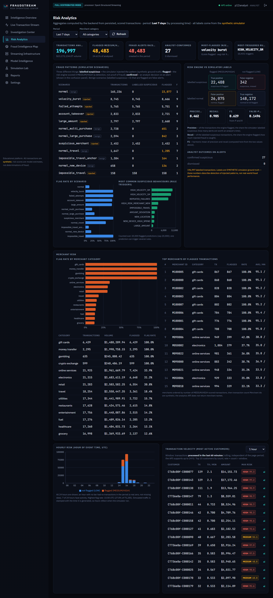 | **Streaming Infrastructure:** service health, Spark query progress and checkpoints, Kafka offsets, consumer lag, DLQ<br/>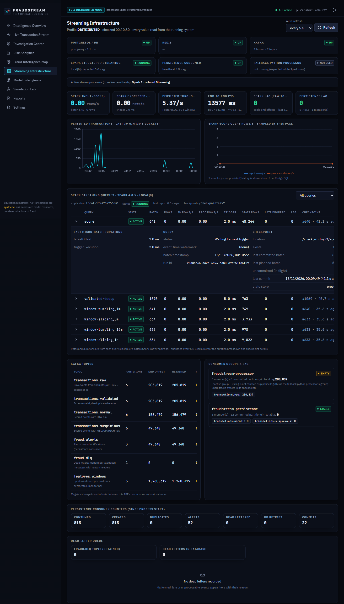 |
| **Model Intelligence:** active models, registry, evaluation by split, confusion matrix, live inference latency<br/>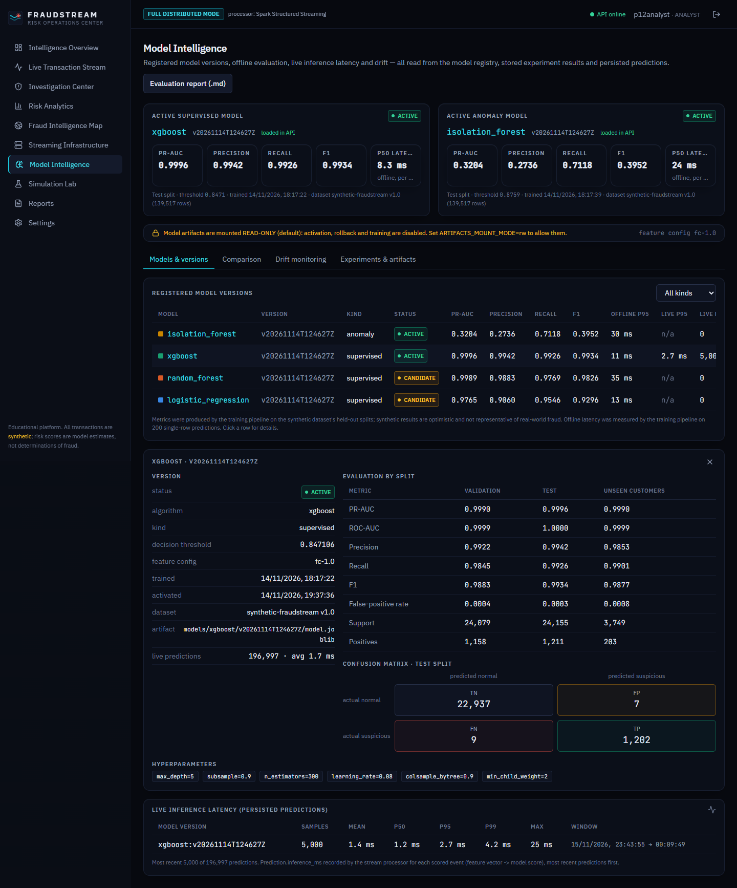 | **Fraud Intelligence Map:** simulated city centroids plotted by latitude and longitude, with city and country tables<br/> |
| **Analyst investigation: alert detail.** Decision explanation, top TreeSHAP feature contributions, actions, notes, audit trail<br/>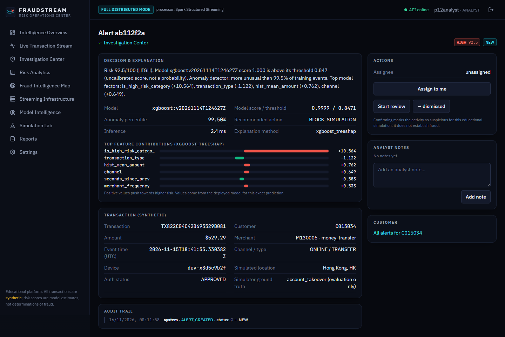 | **Analyst investigation: closed case.** Linked alert, customer history, notes, outcome and the audited status changes<br/>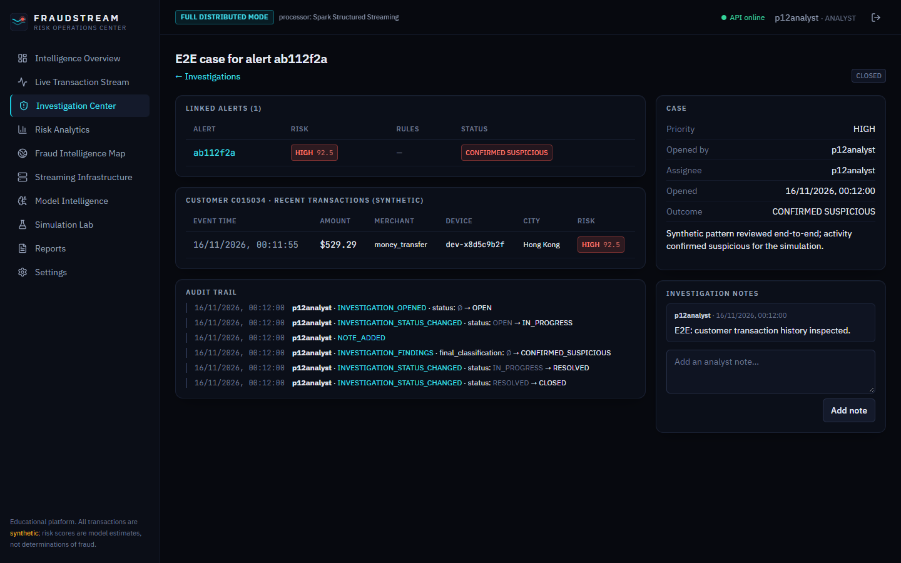 |

<details>
<summary>More pages: Live Stream, Simulation Lab, model comparison and drift, reports, settings</summary>

| | |
|---|---|
| Live Transaction Stream<br/>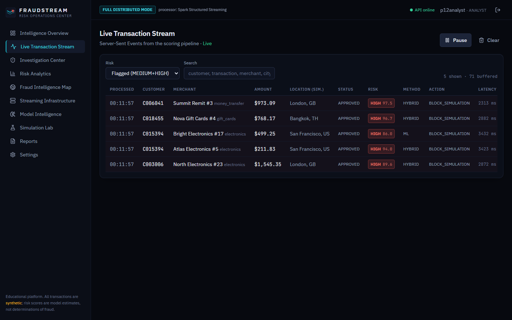 | Simulation Lab<br/>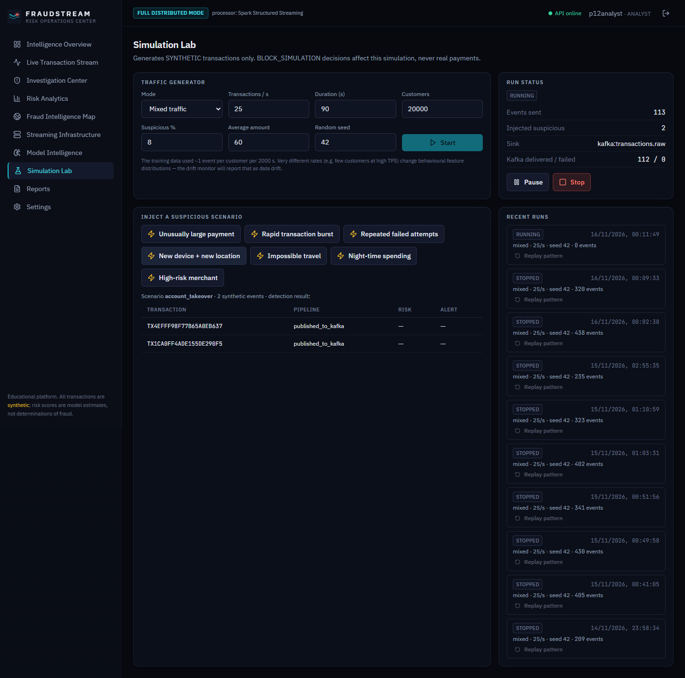 |
| Model comparison<br/>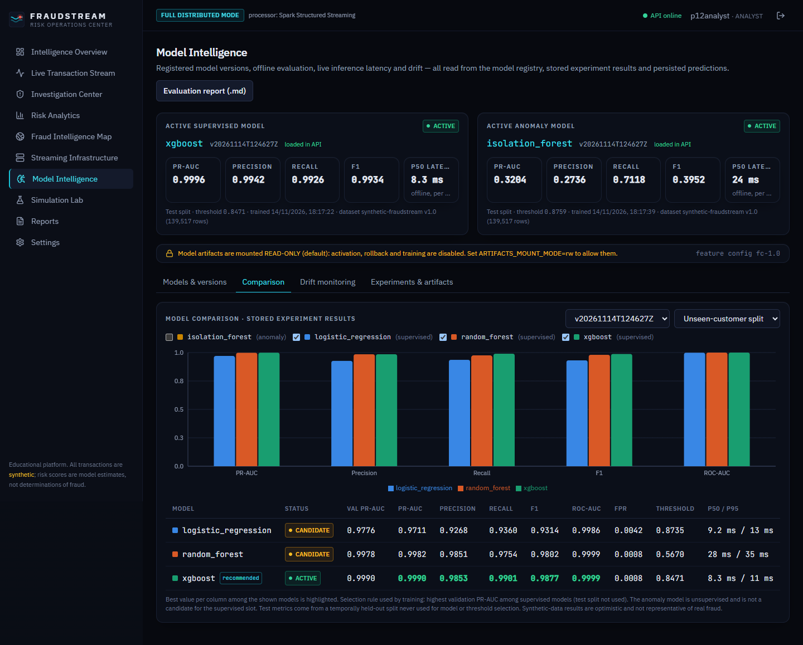 | Drift monitoring<br/>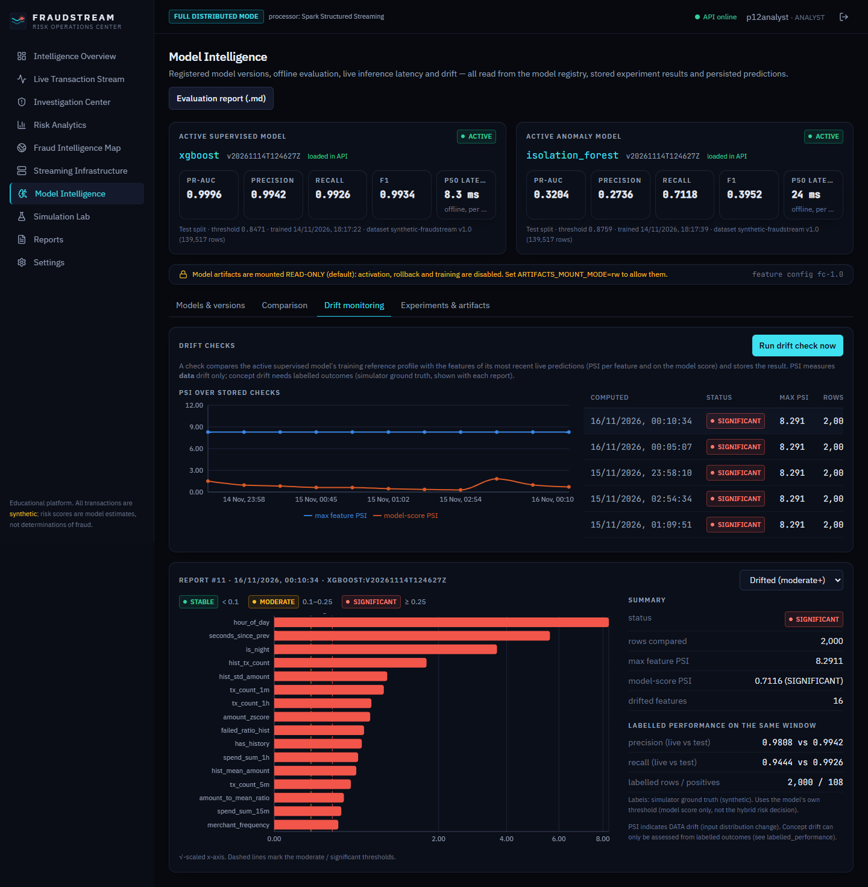 |
| Reports<br/>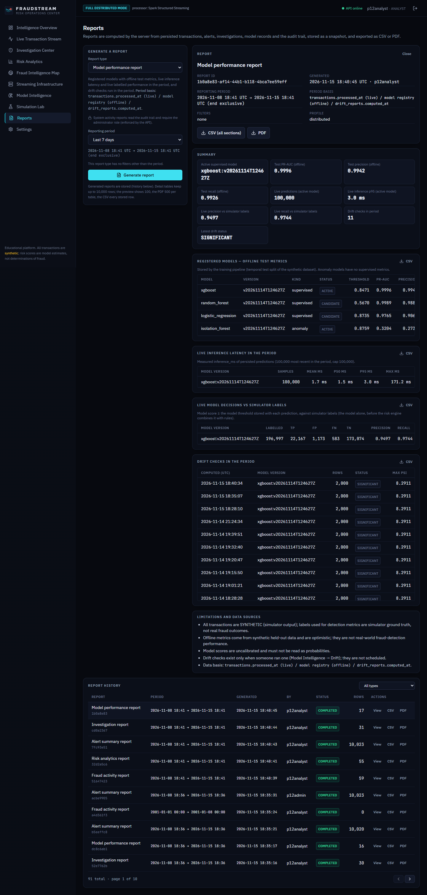 | Settings: risk rules<br/>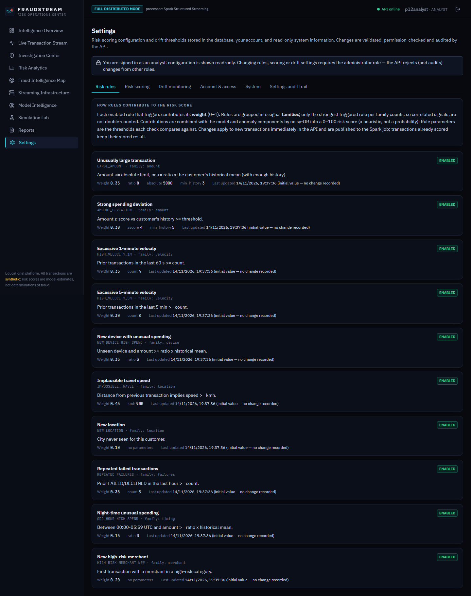 |

</details>

## 9. Machine learning methodology and evaluation

> [!WARNING]
> Every metric in this section was measured on **FraudStream's own synthetic dataset**. The scenarios and the
> features come from the same author, so the classes are close to separable by construction. These numbers validate
> the pipeline wiring and the absence of leakage. They **say nothing about real-world fraud-detection performance**.

**Dataset.** `data/synthetic/synthetic-fraudstream-v1.0.jsonl.gz`: 3,000 simulated customers over 24 simulated hours
(seed 2026), **139,517 events**, **7,064 (5.06 %) labelled suspicious** by the simulator. No public or real dataset was
used. Importers for PaySim and IEEE-CIS exist but were never run.

**Leakage prevention.**

- **Temporal split** by event time, 60 / 20 / 20 % (train 72,034, validation 24,079, test 24,155 rows), plus
  **15 % of customers held out entirely** (unseen-customer test, 3,749 rows).
- Identifiers and the simulator's ground-truth fields are stripped before feature engineering. Features count only
  *prior* events.
- Decision thresholds (max F1) and the recommended model (highest PR-AUC) are chosen on the **validation** split only.
  The test splits are reporting-only.
- Class imbalance (18.6 : 1 in train) is handled with class weights and `scale_pos_weight`.

**Models.** Logistic regression (baseline), random forest and XGBoost (supervised), plus Isolation Forest
(unsupervised anomaly detection). Experiment `v20261114T124627Z`:

| Model | Validation PR-AUC | Test PR-AUC | Test precision | Test recall | Test F1 | Unseen-customer PR-AUC |
|---|---|---|---|---|---|---|
| Logistic regression (baseline) | 0.9776 | 0.9765 | 0.906 | 0.955 | 0.930 | 0.9711 |
| Random forest | 0.9978 | 0.9989 | 0.988 | 0.977 | 0.983 | 0.9982 |
| **XGBoost (active)** | **0.9990** | **0.9996** | **0.994** | **0.993** | **0.993** | 0.9990 |
| Isolation Forest (active anomaly) | 0.3165 | 0.3204 | 0.274 | 0.712 | 0.395 | 0.6045 |

PR-AUC is scikit-learn's average precision. Source: `ml/artifacts/experiments/v20261114T124627Z.json`.

**Risk scoring.** The model score is not used as a probability. The risk engine (`backend/app/risk_engine/engine.py`)
combines three kinds of component:

- a model component, mapped so that the model's threshold equals 0.5;
- an anomaly component, which counts only above the 97th training percentile;
- the strongest triggered rule in each of seven families: amount, velocity, device, location, failures, timing and
  merchant.

Noisy-OR combines them, `risk = 1 − Π(1 − cᵢ)`, scaled to 0–100. LOW < 40 ≤ MEDIUM < 70 ≤ HIGH. All weights, rules and
thresholds are admin-configurable, validated and audited.

**Explainability.** XGBoost predictions carry exact TreeSHAP feature contributions, which are stored with each
prediction and shown on the alert page.

**Drift.** The Population Stability Index of live features and scores is compared against each model's training
reference profile, on demand. It currently reads **SIGNIFICANT** (for example, `hour_of_day` PSI 8.29). Live simulator
traffic is time-stamped near "now" and starts with short customer histories, which differs from the one-day training
set. Labelled live precision and recall were 0.964 and 0.924, against test 0.994 and 0.993. PSI measures input change
only. It does not establish concept drift.

Full methodology and limitations: [docs/DATA_AND_ML.md](docs/DATA_AND_ML.md).

## 10. Streaming pipeline

| Stage | Implementation |
|---|---|
| **Ingestion** | The API's Simulation Lab and `POST /transactions/ingest` produce to `transactions.raw` (6 partitions, key = `customer_id` so each customer's events stay ordered). Producers are idempotent with `acks=all`. A record not acknowledged within 30 s is reported as failed, never silently dropped. |
| **Spark `score` query** | Micro-batches every 2 s, at most 5,000 offsets per trigger. It validates each event against the shared Pydantic schema, drops duplicate `event_id`s using per-customer state, computes behavioural features with `applyInPandasWithState` (RocksDB state store), runs XGBoost and Isolation Forest, applies the risk engine, and routes events to `transactions.normal` (LOW) or `transactions.suspicious` (MEDIUM/HIGH). |
| **Other Spark queries** | `validated-dedup` (10-minute watermark, `dropDuplicatesWithinWatermark`) writes to `transactions.validated`. Two tumbling and two sliding window queries write per-customer aggregates to `features.windows`. |
| **Dead letters** | Invalid events, events more than 10 minutes behind the customer's latest event, and poison records at the persistence stage go to `fraud.dlq` with reason, stage and source-topic headers. |
| **Persistence** | The persistence consumer writes transaction, prediction and alert (plus an `ALERT_CREATED` audit row) in **one database transaction**, then emits `fraud.alerts` and commits Kafka offsets **only after** the DB commit. An event-id check before insert and unique constraints reject re-delivered records (see below). |
| **Live updates** | The consumer publishes each persisted event to Redis pub/sub. The API relays it to the dashboard over Server-Sent Events. |
| **Recovery** | Spark resumes from its checkpoint (offsets plus RocksDB state). The consumer re-reads from its last committed offset. |

#### Delivery semantics

FraudStream does **not** provide end-to-end exactly-once delivery, because Kafka transactions are not used. Instead,
three separate guarantees combine into **effectively-once rows in PostgreSQL**:

| Layer | Guarantee | Mechanism |
|---|---|---|
| Producers → `transactions.raw` | no broker-side duplicates from retries; unacknowledged records reported as failed | idempotent producer, `acks=all`, 30 s delivery timeout |
| Spark → scored topics | **at-least-once** | Source offsets live in the Spark checkpoint. A micro-batch replayed after a crash can write the same scored record to Kafka **twice**. |
| Persistence consumer → PostgreSQL | **idempotent writes** | One DB transaction per event. Kafka offsets are committed **only after** the DB commit, so a crash causes re-delivery, never loss. Duplicates are rejected by an `event_id` lookup before insert and, if two writes race, by the `UNIQUE(transactions.event_id)`, `UNIQUE(predictions.transaction_id)` and `UNIQUE(alerts.transaction_id)` constraints. Rejected records are counted as duplicates, not written. |

As a result, a Kafka topic may hold a duplicate scored record, but the database keeps exactly one transaction,
prediction and alert row per event. Every recorded crash, outage and benchmark run ended with **0 lost and 0 duplicate
rows** in PostgreSQL. Sources: [STREAMING_ARCHITECTURE.md §4 and §6](docs/STREAMING_ARCHITECTURE.md#6-delivery-semantics),
[ARCHITECTURE.md §6](docs/ARCHITECTURE.md#6-delivery-guarantees).

**Measured performance** (one development machine: Intel Core 7 240H, 16 logical CPUs, 15.7 GB RAM, Docker VM with
7.6 GiB; **not production capacity**):

| Measurement | Result |
|---|---|
| End-to-end latency, Kafka → Spark → Kafka → PostgreSQL | p50 / p95 **2.5 / 3.4 s** at 10 events/s; **3.8 / 5.6 s** at 100 events/s. The Spark stage accounts for ~2.2–2.7 s of this (p50), including the 2 s trigger interval. |
| Sustained throughput | ≈ **100–105 events/s** persisted over a 600 s run. Above that, the backlog grows. |
| API ingestion (`POST /transactions/ingest`, one uvicorn worker) | saturates at ≈ 65 accepted events/s, with 0 errors |
| Correctness | **0 lost, 0 duplicate rows, 0 dead letters** in every benchmark run |
| Recovery | Kafka stopped for 20 s: every acknowledged event persisted, with no duplicate rows, lag 0 after 49–56 s. A Spark backlog of 3,000 drained in 53–78 s. A full stack restart was healthy in 22–45 s. |

The bottlenecks under sustained load, in order: the persistence consumer, Kafka's per-message fsync (a deliberate
durability setting), then Spark memory. Full tables and raw results:
[docs/phase12/RELIABILITY_REPORT.md](docs/phase12/RELIABILITY_REPORT.md), `benchmarks/results/*.json`,
[docs/STREAMING_ARCHITECTURE.md](docs/STREAMING_ARCHITECTURE.md).

## 11. API documentation

| Resource | Location |
|---|---|
| Swagger UI (interactive) | `http://127.0.0.1:8080/api/docs` (distributed) · `http://127.0.0.1:8000/api/docs` (host-run API) |
| ReDoc | `/api/redoc` on the same origin |
| OpenAPI schema (JSON) | `/api/openapi.json` |
| Written reference | [docs/API_DOCUMENTATION.md](docs/API_DOCUMENTATION.md): authentication, roles, rate limits, errors, and every endpoint group (health, transactions and live stream, Simulation Lab, alerts and investigations, analytics, models and drift, risk configuration, reports, audit) |

All endpoints are under `/api/v1`. Every endpoint except `GET /health` and `POST /auth/login`, `/auth/refresh` and
`/auth/logout` requires a JWT bearer token.

## 12. Testing and verification

```powershell
.\.venv\Scripts\python -m pytest                        # backend, ML, simulator and streaming logic (no Docker needed)
cd frontend; npx vitest run; npm run typecheck; cd ..   # frontend unit tests + type check
```

Integration suites (container, Kafka, Spark and Playwright E2E) need a running stack. Some of them **restart or crash
containers**, so run the disruptive ones only against an isolated stack. The exact commands are in
[CONTRIBUTING.md §5](CONTRIBUTING.md#5-testing).

**Latest recorded full verification** (Phase 15, on a throw-away stack; individual runs are in
[DEVELOPMENT_STATUS.md](DEVELOPMENT_STATUS.md)):

| Suite | Result |
|---|---|
| pytest | 224 passed, 2 skipped (Windows) · 226 passed (Linux) |
| Vitest | 78 passed |
| Kafka integration | 12 passed |
| Container suite (incl. failure injection) | 25 passed |
| Spark integration | 6 passed |
| Playwright E2E | 12 passed per profile (local and distributed) |
| Backup → restore → `verify_restore.py` | PASS (10/10 checks) |

**Continuous integration.** Two GitHub Actions workflows are included. Neither deploys anything or uses repository
secrets, and every action is pinned to a commit SHA.

- [`ci.yml`](.github/workflows/ci.yml) runs on pull requests and pushes to `main`. It covers ruff and pytest; Vitest,
  type check and build; Compose validation; repository hygiene, gitleaks, pip-audit and npm audit; and Kafka
  integration.
- [`full-stack.yml`](.github/workflows/full-stack.yml) runs manually and weekly. It builds the images, runs the
  distributed stack's container, Spark and E2E suites and the local profile's E2E run, and makes a Trivy image scan.

Both workflows were validated locally (actionlint, plus every job's commands run on a development machine) before
the repository was published. Details: [CONTRIBUTING.md §11](CONTRIBUTING.md#11-continuous-integration).

## 13. Security considerations

- **Authentication.** Argon2id password hashes and 30-minute HS256 JWT access tokens. Rotating refresh tokens live in
  an `HttpOnly`, `SameSite=Strict` cookie; reusing a rotated token revokes all of that user's sessions. Login is rate
  limited to 10/min per client, and the API to 1,200/min per token.
- **Authorization.** Two roles, enforced on the server. Denied configuration attempts are themselves audited.
- **Configuration integrity.** Updates require `expected_updated_at`. Invalid values return 422, a missing version 428
  and a stale version 409; on PostgreSQL the row is locked with `SELECT … FOR UPDATE`.
- **Audit logging.** An append-only table records logins, triage, configuration changes (old → new values), rejected
  and denied attempts, reports and model actions.
- **Secrets.** No credentials are in the repository. `.env` is generated locally with random values, is gitignored and
  is excluded from Docker build contexts. CI runs gitleaks over the full Git history.
- **Containers.** Non-root application, Spark and nginx images. Host ports are bound to `127.0.0.1`, the API container
  is not published, and model artifacts and the dataset are mounted read-only. Every long-running service has a memory
  limit and a health check.
- **Dependencies.** pip-audit and npm audit gate CI against a reviewed advisory baseline. 105 of 123 reviewed
  advisories are fixed, and the remaining 18 are classified in [SECURITY.md §10](SECURITY.md#10-dependency-findings-reviewed-2026-11-16-phase-15).
- **Not provided.** **No TLS**, no Kafka authentication, no MFA, no Content-Security-Policy header and no high
  availability. The stack is safe only because everything is bound to `127.0.0.1`. It is not ready for a networked
  deployment.

Details: [SECURITY.md](SECURITY.md) and [docs/phase12/SECURITY_REVIEW.md](docs/phase12/SECURITY_REVIEW.md).

## 14. Known limitations

- **Synthetic data only.** The models learn the simulator's designed scenarios, not real fraud. Real fraud is
  adversarial, labels arrive late and noisy, and base rates are far below the dataset's 5.06 %, which flatters
  precision. No public or real dataset has been evaluated.
- **One training run.** One dataset, one seed, one experiment. No confidence intervals, cross-validation or
  hyperparameter search are reported. Max-F1 thresholds treat false positives and false negatives as equally costly.
- **Single host, no high availability.** Spark runs in **local mode in one container**, not as a cluster. Kafka is a
  single broker with replication factor 1, and PostgreSQL and Redis are single instances. Resilience comes from
  Docker restart policies, checkpoints and idempotent persistence only.
- **Capacity.** About 100 events/s on the development machine. The persistence consumer is the first bottleneck, and
  the API runs a single uvicorn worker by design.
- **Drift reads SIGNIFICANT** because simulated live timing differs from the one-day training set. It is measured and
  explained, and PSI does not detect concept drift.
- **Geography** uses 38 public city centroids, not addresses. A map point is not a confirmed fraud location.
- **No retraining loop.** Retraining is manual, analyst decisions are not fed back into training labels, and model
  activation is disabled while artifacts are mounted read-only (the default).
- **Product gaps.** No user-management UI (the API exists), no training trigger in the UI, no code-split frontend
  bundle (≈ 854 kB), no data-retention policy, and no scheduled backups.
- **Security gaps.** No TLS, Kafka authentication, MFA or CSP (see [§13](#13-security-considerations)).

## 15. Future improvements

None of these is implemented yet:

- **Evaluation:** evaluate on a public dataset (the PaySim and IEEE-CIS importers exist), add cost-sensitive threshold
  selection, and report confidence intervals across seeds.
- **Feedback loop:** use analyst classifications as delayed labels for retraining and monitoring.
- **Throughput:** batch persistence transactions (1.36× measured in isolation), revisit Kafka's fsync-per-message
  durability setting, and tune Spark memory.
- **Deployment hardening:** TLS at nginx with secure cookies, Kafka authentication, a Content-Security-Policy, and a
  multi-broker Kafka and real Spark cluster deployment.
- **Dependencies:** Vite ≥ 6.4.4 / Vitest ≥ 4.1.12, React Router 7.x, and PyArrow ≥ 23.0.1 with the next Spark image
  rebuild.
- **Product:** a user-management UI, frontend code-splitting, a data-retention policy and scheduled backups.
- **Code quality:** enforce the remaining 216 ruff style findings in CI.

## 16. Documentation map

| Document | Contents |
|---|---|
| [docs/PROJECT_OVERVIEW.md](docs/PROJECT_OVERVIEW.md) | One-page technical summary for interviews |
| [docs/ARCHITECTURE.md](docs/ARCHITECTURE.md) | Components, data flows, protocols, storage, design decisions |
| [docs/DIAGRAMS.md](docs/DIAGRAMS.md) | Mermaid diagrams: system, transaction lifecycle, ML lifecycle, recovery, backup |
| [docs/STREAMING_ARCHITECTURE.md](docs/STREAMING_ARCHITECTURE.md) | Kafka topics, Spark queries, checkpoints, persistence, DLQ, throughput |
| [docs/DATA_AND_ML.md](docs/DATA_AND_ML.md) | Dataset, features, leakage prevention, models, thresholds, risk scoring, drift |
| [docs/API_DOCUMENTATION.md](docs/API_DOCUMENTATION.md) | Endpoints, roles, parameters, errors, concurrency rules |
| [docs/OPERATIONS.md](docs/OPERATIONS.md) | Start/stop, health, logs, failure recovery, backup/restore, troubleshooting |
| [docs/DEMO_GUIDE.md](docs/DEMO_GUIDE.md) | 10–15 minute live demonstration script |
| [docs/DEMO_VIDEO_SCRIPT.md](docs/DEMO_VIDEO_SCRIPT.md) | Two-minute recorded demo: timestamped script and storyboard |
| [docs/screenshots/](docs/screenshots/README.md) | Desktop and mobile screenshots of every page, with provenance |
| [docs/phase12/](docs/phase12/) | Reliability report, backup/restore evidence, security review |
| [benchmarks/BENCHMARKS.md](benchmarks/BENCHMARKS.md) | Benchmark methodology and scripts |
| [SECURITY.md](SECURITY.md) | Security controls, dependency findings and known gaps |
| [CONTRIBUTING.md](CONTRIBUTING.md) | Developer onboarding, tests, data-safety rules, CI |
| [DEVELOPMENT_STATUS.md](DEVELOPMENT_STATUS.md) | Phase-by-phase engineering log with every test run |
| [RELEASE_NOTES.md](RELEASE_NOTES.md) | Release 1.0.0: capabilities, measured results, limitations |

## 17. License

Released under the [MIT License](LICENSE).
