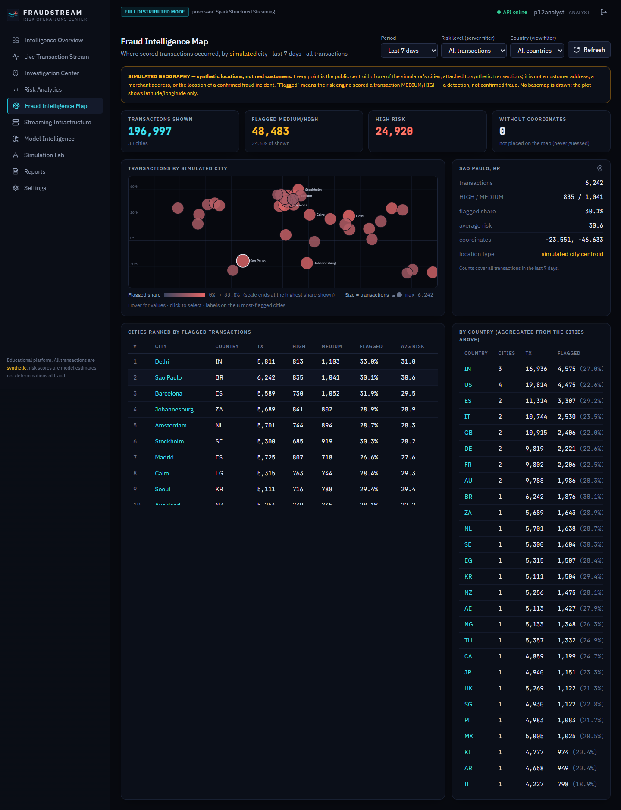
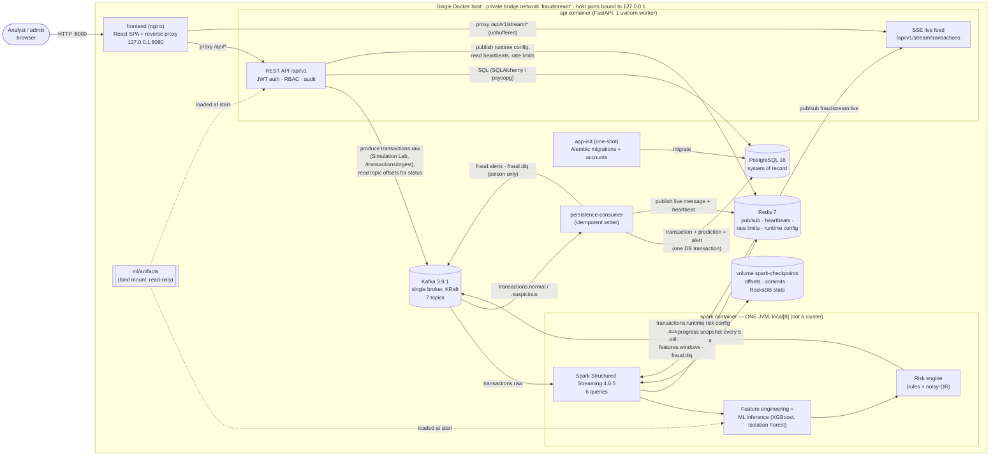

# FraudStream

**A real-time fraud-detection platform for synthetic payment transactions. It streams events through Kafka, scores
them with Spark Structured Streaming and an ML model plus risk engine, and gives analysts a dashboard for
investigations.**

> **Educational project, synthetic data only.** Every transaction, customer, merchant and location is generated by
> the built-in simulator. Risk scores are model estimates, not determinations of fraud. Nothing real is ever blocked:
> the `BLOCK_SIMULATION` action exists only inside the simulation. All performance figures come from **one development
> machine** and are not production capacity.


<sub>Captured by the Playwright E2E suite on the isolated Phase 12 stack after the load benchmarks, which is why the
p95 latency and flagged counts are high. See [docs/screenshots](docs/screenshots/README.md).</sub>

---

## Contents

1. [What it does](#1-what-it-does)
2. [Features](#2-features)
3. [Technology stack](#3-technology-stack)
4. [Architecture](#4-architecture)
5. [Installation and execution](#5-installation-and-execution)
6. [Demonstration](#6-demonstration)
7. [Performance (measured)](#7-performance-measured)
8. [Data integrity and research limitations](#8-data-integrity-and-research-limitations)
9. [Security and reliability](#9-security-and-reliability)
10. [Documentation map](#10-documentation-map)
11. [Roadmap](#11-roadmap)

---

## 1. What it does

**Problem.** Card and account fraud has to be caught *while* transactions flow: decisions need per-customer behaviour
(velocity, spending deviation, new devices, impossible travel) computed over a live stream, a calibrated way to
combine model output with explainable rules, and a workflow where analysts can review what the system flagged.

**What FraudStream implements:**

- A deterministic **transaction simulator** with seven labelled suspicious scenarios.
- A **Kafka → Spark Structured Streaming → Kafka → PostgreSQL** pipeline with schema validation, event-id
  deduplication, per-customer stateful features, watermarks and windows, a dead-letter topic, and checkpointed
  recovery.
- **Supervised and anomaly ML models** (XGBoost, random forest, logistic regression, Isolation Forest) trained with a
  temporal split and evaluated on a held-out test split and an unseen-customer split.
- A **hybrid risk engine**: model score, anomaly score and ten configurable rules, combined by noisy-OR into a
  0–100 score with LOW / MEDIUM / HIGH categories.
- A **React dashboard** behind nginx. It covers alerts, investigations, model intelligence, streaming health, risk
  analytics, a geographic view, reports and audited settings.

**Why it is technically interesting**

- The same feature, ML and risk code runs in three places: inside Spark's Python workers
  (`applyInPandasWithState`), in the API's in-process local pipeline, and in an opt-in fallback processor. Tests check
  that their output matches.
- Delivery is **effectively-once at the database boundary**. Spark output is at-least-once; the persistence consumer
  commits Kafka offsets only after the database commit, and unique constraints absorb replays. Crash, outage and
  backlog tests verify this with zero lost and zero duplicate rows.
- The ML evaluation is designed against leakage: temporal ordering, a customer holdout, thresholds chosen on
  validation only, and ground-truth fields that can never reach the model.
- The project is measured, not just built. It includes stage-separated latency benchmarks, failure injection, a
  tested backup/restore cycle and a security review, all documented with their raw results.

**Intended users and use cases.** Students and engineers studying streaming ML systems; reviewers who want to see a
complete pipeline running end to end; interview and portfolio demonstration. It is **not** a production fraud system
and has not been evaluated on real transactions.

## 2. Features

| Area | What exists (all verified in the running application) |
|---|---|
| **Transaction simulation** | `simulator/generator.py`: seeded customer population, 38 public city centroids, 7 scenarios (`large_amount`, `velocity_burst`, `failed_attempts`, `account_takeover`, `impossible_travel`, `odd_hour`, `suspicious_merchant`). Simulation Lab page: start/pause/stop runs, inject a single scenario, saved configurations, replay. |
| **Kafka ingestion** | 7 topics (`transactions.raw/.validated/.normal/.suspicious`, `fraud.alerts`, `fraud.dlq`, `features.windows`); idempotent producers (`acks=all`); `POST /transactions/ingest` for single events. |
| **Spark Structured Streaming** | `streaming/spark/fraud_stream_job.py`: 6 queries — `score` (validation, dedup, stateful features, ML, risk), `validated-dedup` (watermark + `dropDuplicatesWithinWatermark`), 2 tumbling and 2 sliding window queries; RocksDB state store; checkpoints in a named volume. **Local mode** (`local[8]`) in a single container. |
| **Feature engineering** | 29 versioned features (`fc-1.0`): amount statistics, 1 m / 5 m / 1 h velocity, 15 m / 1 h spend, z-score, new device / location / merchant, geo-velocity, failure counts, time-of-day. |
| **ML fraud scoring** | Active: XGBoost (supervised) + Isolation Forest (anomaly), loaded read-only from `ml/artifacts`. |
| **Risk rules and scoring** | 10 rules in 7 signal families (only the strongest rule per family counts), noisy-OR combination, thresholds 40 / 70, actions ALLOW / REVIEW / BLOCK_SIMULATION. |
| **Alerts and investigations** | Alerts for MEDIUM/HIGH; triage (status, assignment, notes), investigations (link alerts, findings, final classification), CSV export, per-alert audit history. |
| **Model Intelligence** | Registry with test/validation metrics, model comparison, live inference latency, drift tab (PSI per feature, history), experiment and artifact inspection (SHA-256 of every file). Activation and rollback are admin-only and disabled while artifacts are mounted read-only. |
| **Streaming Infrastructure** | Live health of PostgreSQL, Redis, Kafka, Spark, consumer; per-query Spark progress and checkpoints; topic offsets, consumer-group lag, DLQ. |
| **Risk Analytics** | Scenario patterns (labelled vs flagged), confusion matrix against simulator labels, merchant categories, hourly distribution, velocity leaders — all filtered server-side. |
| **Fraud Intelligence Map** | Dependency-free SVG latitude/longitude plot of simulated city centroids (no basemap), with city and country tables. |
| **Reports** | 6 report types computed by SQL over a UTC period, stored as snapshots, exported as CSV (formula-injection guarded) and PDF (embedded fonts). |
| **Settings** | Risk rules, scoring thresholds and drift thresholds (admin, validated, confirmation dialog, optimistic concurrency); account and role matrix; read-only system information; settings audit trail. |
| **Audit trail** | Every login, alert/investigation action, configuration change, rejected and denied attempt, report generation and model action is written to `audit_logs`. |
| **Drift monitoring** | Population Stability Index of live features and scores against the training reference profile, on demand, with stored history. |
| **Backup and recovery** | `scripts/backup.py`, `restore.py`, `verify_restore.py`: snapshot-consistent dumps, checksums, restore into empty targets only, verification against the running stack. |

<p>


</p>

## 3. Technology stack

Versions are the pins in `frontend/package.json`, `backend/requirements.txt`,
`infrastructure/spark/requirements-spark.txt` and the Dockerfiles / `docker-compose.yml`.

| Layer | Technology |
|---|---|
| **Frontend** | React 18.3.1, TypeScript 5.6.3, Vite 5.4.21, React Router 6.30.6, TanStack Query 5.62.8, Recharts 2.15.0, Tailwind CSS 3.4.17, react-hook-form 7.54.2, lucide-react 0.468.0 |
| **Backend** | Python 3.12, FastAPI 0.163.1 (Starlette 1.10.0), uvicorn 0.32.1, Pydantic 2.10.3, pydantic-settings 2.7.0, SQLAlchemy 2.0.36, Alembic 1.14.0, psycopg 3.2.3, PyJWT 2.15.1, argon2-cffi 23.1.0, redis-py 5.2.1, confluent-kafka 2.6.1, reportlab 4.2.5 + Pillow 13.0.0, python-multipart 0.0.33 |
| **Machine learning** | scikit-learn 1.5.2, XGBoost 2.1.3, NumPy 2.1.3, pandas 2.2.3, joblib 1.4.2 (identical pins in the API and Spark images so artifacts load identically) |
| **Streaming** | Apache Kafka 3.9.1 (KRaft, single broker), PySpark 4.0.5 + `spark-sql-kafka-0-10_2.13:4.0.5`, PyArrow 18.1.0, OpenJDK 17 |
| **Databases** | PostgreSQL 16 (distributed system of record), SQLite (local profile), Redis 7 (pub/sub, heartbeats, rate limits, runtime config) |
| **Infrastructure** | Docker Compose (profiles `distributed`, `local`, `spark`, `python-processor`), `python:3.12-slim-bookworm`, `node:22-alpine` (build), `nginxinc/nginx-unprivileged:1.30.6-alpine3.24` (pinned by digest, `apk upgrade` at build), tini |
| **Testing** | pytest 9.2.0, httpx 0.28.1, ruff 0.8.4, Vitest 2.1.9, Testing Library (React 16.1.0), jsdom 25.0.1, Playwright 1.65.1 |

## 4. Architecture



**Two execution profiles**, always chosen explicitly. The application never switches between them on its own:

| Profile | Components | Use |
|---|---|---|
| **distributed** | Kafka + Spark + PostgreSQL + Redis + persistence consumer + API + nginx, all in containers | the full platform (dashboard on `127.0.0.1:8080`) |
| **local** | one API container (or host process) running the same feature/ML/risk code **in-process** on SQLite, + nginx | quick development; no Kafka/Spark/Redis/PostgreSQL (`127.0.0.1:8081`) |

In the distributed profile the API **never** falls back to in-process scoring. If Kafka is down, the Simulation Lab
returns HTTP 503 naming Kafka. More diagrams (transaction lifecycle, ML lifecycle, failure recovery, backup/restore)
are in [docs/DIAGRAMS.md](docs/DIAGRAMS.md), and a component-by-component description is in
[docs/ARCHITECTURE.md](docs/ARCHITECTURE.md).

## 5. Installation and execution

All commands are **Windows PowerShell**, run from the repository root. On Linux/macOS, use `.venv/bin/python` instead
of `.\.venv\Scripts\python`.

### 5.1 Prerequisites

| Tool | Version used | Needed for |
|---|---|---|
| Docker Desktop (Compose v2) | 29.9.2 / Compose v5.6.1 | both containerised profiles; give the Docker VM **≥ 8 GB RAM** for the distributed profile (Spark alone has a 3 GiB limit) |
| Python | 3.12 | helper scripts (`new_env.py`, backups), tests, host-run API |
| Node.js / npm | Node 22+ (26.13.1 used) | frontend tests, host-run dev server |
| Disk | ~7 GB for images (`fraudstream-spark:local` 3.75 GB, `fraudstream-app:local` 1.97 GB) | |

Java is **not** required on the host. Spark runs in its own image with OpenJDK 17.

### 5.2 Environment setup

```powershell
python -m venv .venv
.\.venv\Scripts\python -m pip install -r backend\requirements-dev.txt
.\.venv\Scripts\python scripts\new_env.py          # creates .env with fresh random secrets (refuses to overwrite)
```

`scripts\new_env.py` copies `.env.example` and replaces every secret with a random value: JWT secret, PostgreSQL and
Redis passwords, and the admin/analyst login passwords (22 random characters that satisfy the password policy). For an
existing `.env`, use `--add-missing`, which appends new keys and never changes existing values. `.env` is gitignored
and excluded from every Docker build context. **Never commit it.**

The dataset `data/synthetic/` and the trained models in `ml/artifacts/` must be present. If the dataset is missing,
`python -m ml.training.train` regenerates it deterministically, but **retraining produces different model files**, so
keep the existing artifacts if you have them (see [CONTRIBUTING.md](CONTRIBUTING.md#8-model-artifacts-and-datasets)).

### 5.3 Distributed profile (full platform)

```powershell
docker compose --env-file .env --profile distributed up -d --build
docker compose --env-file .env --profile distributed ps     # repeat until every service shows (healthy)
```

- First start builds three images (several minutes). Spark has a 120 s health start period.
- **Database initialisation is automatic.** The one-shot `app-init` container runs the Alembic migrations
  (`python -m app.cli migrate`) and creates the two login accounts from `.env`. It never changes an existing account.
- Dashboard: **http://127.0.0.1:8080** (use `127.0.0.1`, not `localhost`, on Windows).
- API docs (Swagger UI) through the same origin: http://127.0.0.1:8080/api/docs.

### 5.4 Local profile (no Kafka/Spark)

Containerised:

```powershell
docker compose --env-file .env --profile local up -d --build api-local frontend-local
# dashboard: http://127.0.0.1:8081  (SQLite in the named volume local-data)
```

Host processes (for backend/frontend development):

```powershell
# terminal 1 — API on 127.0.0.1:8000 (FRAUDSTREAM_PROFILE=local in .env; SQLite at data\fraudstream.db)
$env:PYTHONPATH = "$PWD;$PWD\backend"
.\.venv\Scripts\python -m app.cli migrate
.\.venv\Scripts\python -m app.cli dev-bootstrap   # development only: creates admin/analyst with random passwords
.\.venv\Scripts\python -m uvicorn app.main:create_app --factory --host 127.0.0.1 --port 8000

# terminal 2 — Vite dev server on 127.0.0.1:5173 (proxies /api to :8000)
cd frontend; npm ci; npm run dev
```

`dev-bootstrap` writes the generated passwords to `.dev-credentials.txt` (gitignored). The host API writes the derived
`runtime_config.json` into `ml/artifacts/` unless you set `RUNTIME_CONFIG_DIR` to another directory.

### 5.5 Login credentials

No credentials are stored in this repository. The account names are `FRAUDSTREAM_ADMIN_USERNAME` /
`FRAUDSTREAM_ANALYST_USERNAME` in your `.env` (default `admin` / `analyst`), and their passwords are the random values
`new_env.py` generated in the same file. Roles:

| Role | Can |
|---|---|
| `ANALYST` | view everything except the audit trail; triage alerts; run investigations; run simulations; generate five report types |
| `ADMIN` | everything above + change risk rules/scoring/drift settings, users, model activation (when artifacts are writable), dataset upload, audit trail, system-activity report |

More accounts can be added with `POST /api/v1/users` (admin) or
`python -m app.cli create-user --username <name> --role ANALYST --password-env <VAR>`.

### 5.6 Running tests

```powershell
.\.venv\Scripts\python -m pytest                        # unit + backend + ML + streaming logic (no Docker needed)
cd frontend; npx vitest run; npm run typecheck; cd ..   # frontend unit tests + type check
```

With the distributed stack running, there are also integration suites: container, Kafka, Spark and Playwright E2E.
Some of them **restart or crash containers**, so run the disruptive ones only against an isolated stack. See
[CONTRIBUTING.md §5](CONTRIBUTING.md#5-testing) for the exact commands.

Latest recorded results (Phase 15 regression; see [DEVELOPMENT_STATUS.md](DEVELOPMENT_STATUS.md) for the exact runs):
pytest **224 passed, 2 skipped** on Windows and **226 passed, 0 skipped** on Linux; Vitest **78 passed**; Kafka
integration **12 passed**; container suite **25 passed** (incl. failure injection); Spark integration **6 passed**;
Playwright E2E **12 passed** on each profile; backup → restore PASS. All runs used a fresh throw-away stack
(`fraudstream-p15`). The release archive was also extracted into a new folder and its local profile built, started,
smoke-tested and E2E-tested from there.

### 5.7 Continuous integration

Two GitHub Actions workflows are included (no deployment, no repository secrets, actions pinned to commit SHAs):

| Workflow | Trigger | Jobs |
|---|---|---|
| [`ci.yml`](.github/workflows/ci.yml) | pull requests, pushes to `main`, manual | **backend** (ruff correctness rules + pytest) · **frontend** (`npm ci`, Vitest, type check, build) · **compose** (every profile validated, referenced files present; nothing started) · **security** (repository hygiene, gitleaks over the full history, pip-audit + npm audit gated on a reviewed baseline) · **kafka-integration** (real Kafka, PostgreSQL and Redis on the runner) |
| [`full-stack.yml`](.github/workflows/full-stack.yml) | manual, weekly | builds the images, runs the distributed stack: container suite (incl. failure injection), Spark integration, Playwright E2E (desktop + 390 px), the containerised local profile with its E2E run, Trivy image scan (report only) |

The workflows were written and validated **locally** (actionlint, and every job's commands run on this machine,
the backend and frontend jobs inside Linux containers from a clean copy of the publishable files). They have **not
yet run on GitHub**, because the repository is not published. Details, the dependency-advisory baseline and local
reproduction: [CONTRIBUTING.md §11](CONTRIBUTING.md#11-continuous-integration).

### 5.8 Stopping safely

```powershell
docker compose --env-file .env --profile distributed stop     # stops containers; all data is kept
docker compose --env-file .env --profile distributed start    # or `up -d` to start again
```

`stop` and `down` (without `-v`) keep every named volume: database, Kafka log, Spark checkpoints and uploads.
**`docker compose down -v` deletes all data, including the Kafka log and Spark checkpoints. Do not use it unless you
mean to.** Take a backup first ([OPERATIONS.md §6](docs/OPERATIONS.md#6-backup-and-restore)).

## 6. Demonstration

A scripted 10–15 minute walkthrough with expected observations and fallback steps is in
[docs/DEMO_GUIDE.md](docs/DEMO_GUIDE.md). In short:

1. Start the distributed profile and log in as the analyst.
2. **Intelligence Overview**: processed volume, flagged share, active model metrics, recent alerts.
3. **Simulation Lab**: start a `mixed` run at ~10 events/s, or inject a single `account_takeover` scenario.
4. **Live Transaction Stream**: scored events arrive over SSE within a few seconds.
5. **Investigation Center → alert**: read the explanation (triggered rules, model and anomaly components), set it under
   review, open an investigation, resolve it with a classification, close it.
6. **Streaming Infrastructure**: the Spark queries, checkpoints, Kafka offsets and lag that produced it.
7. **Model Intelligence**: registry, comparison, drift.
8. **Risk Analytics** and **Fraud Intelligence Map**: flagged versus labelled behaviour by scenario, merchant, hour
   and city.
9. **Reports**: generate an alert summary for the last 7 days and download the PDF.
10. **Settings** (as admin): change a drift threshold through the confirmation dialog, then find the change in the
    settings audit trail.

## 7. Performance (measured)

Measured in Phase 12 on **one development machine**: Windows 11, Intel Core 7 240H with 16 logical CPUs, 15.7 GB RAM,
Docker Desktop VM with 16 vCPUs and 7.6 GiB. The stack was an isolated copy of the application (own network, volumes
and secrets) restored from a backup, with the default container memory limits (Spark 3 GiB, `local[8]`). Full tables:
[docs/phase12/RELIABILITY_REPORT.md](docs/phase12/RELIABILITY_REPORT.md); raw results: `benchmarks/results/*.json`.
**These numbers describe that machine, not production capacity.**

| Measurement | Result |
|---|---|
| End-to-end latency, Kafka → Spark → Kafka → PostgreSQL (60 s per level) | p50 / p95: **2.5 / 3.4 s** at 10 ev/s · 2.6 / 3.5 s at 25 · 2.7 / 3.7 s at 50 · **3.8 / 5.6 s** at 100 ev/s. Spark accounts for ~2.2–2.7 s of this, including the 2 s trigger interval. |
| Overload | 150 ev/s offered → 115 ev/s persisted, p95 24 s (falls behind) |
| **Sustained throughput** | 600 s at 112.6 ev/s offered → **105.5 ev/s persisted**, backlog grows (p95 57 s). Sustainable rate on this machine is **≈ 100–105 ev/s**. |
| Backlog burst (5,000 events at once) | Spark: one 14.7 s micro-batch (≈ 340 ev/s); persistence 217 ev/s |
| Correctness | **0 lost, 0 duplicate rows, 0 dead letters** in every run |
| **API ingestion** (`POST /transactions/ingest`, one uvicorn process) | saturates at **≈ 65 accepted ev/s** (HTTP p50 243 ms), 0 errors |
| API reads (29 endpoints, concurrency 1 / 8 / 32, ~190k transactions) | 0 errors at every level after the Phase 12 PostgreSQL fix; most single-request p50 values are 8–70 ms, and heavy analytics take 0.2–0.6 s |
| Reports | each of the 6 types generates in ≤ 2.3 s; PDF ≤ 2.5 s (~190k transactions, ~45k alerts) |
| **Recovery** | Kafka stopped 20 s: every acknowledged event persisted exactly once, lag 0 after 49–56 s · Spark backlog of 3,000 drained in 53–78 s · Redis outage: persistence continued, live feed back 16–21 s after restart · full stack stop + `up -d`: healthy in 22–45 s, first new event persisted 41–77 s after `up` · restore from backup: healthy in 43–48 s |

The bottleneck order under sustained load is: persistence consumer, then Kafka's per-message fsync (a deliberate
durability setting), then Spark memory. The API process is single-worker by design.

## 8. Data integrity and research limitations

- **Synthetic data.** Training data and live traffic come from FraudStream's own simulator. The suspicious scenarios
  are designed patterns, so the models learn to recognise the simulator's scenarios, not real fraud.
- **Training/test separation.** Splits are temporal (60 / 20 / 20 % by event time) with 15 % of customers held out
  entirely. Thresholds and the recommended model are chosen on the validation split only; the test splits are
  reporting-only. Identifiers and ground-truth fields are stripped before feature engineering.
- **Model evaluation.** The active XGBoost model reaches test PR-AUC 0.9996, precision 0.994 and recall 0.993. These
  are **optimistic, synthetic numbers** and say nothing about real-world performance. The scenarios are separable by
  construction, and simulator labels are the only ground truth.
- **Simulator labels.** "Labelled suspicious" means the simulator injected a scenario. Some scenario events are
  labelled benign (for example `impossible_travel_anchor`). Analyst decisions in the UI are a separate signal.
- **Geography.** Each location is the public centroid of one of 38 cities. It is not an address, and a map point is
  not a confirmed fraud location. No basemap is drawn.
- **Drift.** PSI measures *input distribution* change against the 24-hour training profile. Live simulator traffic
  (event times close to "now", short customer histories) differs from that profile, so drift currently reads
  SIGNIFICANT (e.g. `hour_of_day` PSI 8.29). This is measured and shown as such. PSI does not establish concept drift.

Details: [docs/DATA_AND_ML.md](docs/DATA_AND_ML.md).

## 9. Security and reliability

- **Authentication:** Argon2id password hashes; 30-minute HS256 JWT access tokens; rotating refresh tokens in an
  `HttpOnly`, `SameSite=Strict` cookie, where re-use of a rotated token revokes all of that user's sessions. Login is
  limited to 10/min per client and the API to 1,200/min per token.
- **RBAC:** two roles, enforced on the server. Denied configuration attempts are themselves audited.
- **Configuration concurrency:** rule, risk-setting and setting updates must send `expected_updated_at`. Invalid
  values return **422**, a missing version returns **428**, and a stale version returns **409**. On PostgreSQL the row
  is locked with `SELECT … FOR UPDATE`.
- **Audit logging:** an append-only application table covering logins, triage, configuration changes (old → new),
  rejected and denied attempts, reports and model actions.
- **Containers:** non-root application, Spark and nginx images; host ports bound to 127.0.0.1; the API is not
  published; model artifacts and the dataset are mounted read-only; Spark sees only the source directories it needs,
  not `.env`; memory limits and health checks on every long-running service.
- **Backup and restore:** tested twice end to end (see §7).
- **Automated checks (CI):** repository hygiene, gitleaks secret scan over the Git history, pip-audit and npm audit
  that block any advisory not already reviewed, and a weekly Trivy scan of the base images. Phase 15 upgraded PyJWT,
  FastAPI/Starlette, python-multipart, Pillow, react-router and the nginx base image: **105 of the 123** reviewed
  advisories are fixed and the frontend image has **0** HIGH/CRITICAL OS findings (was 68). The **18** that remain
  (pyarrow inside the Spark image; Vite/Vitest dev tooling; two react-router advisories that need 7.x) are classified
  in [SECURITY.md §10](SECURITY.md#10-dependency-findings-reviewed-2026-11-16-phase-15).
- **Not provided:** **no TLS** anywhere, no Kafka authentication, **no high availability** (single host, single
  broker with RF=1, single PostgreSQL and Redis; Docker restart policies only), no MFA, no CSP header.

Details: [SECURITY.md](SECURITY.md) and [docs/OPERATIONS.md](docs/OPERATIONS.md).

## 10. Documentation map

| Document | Contents |
|---|---|
| [docs/PROJECT_OVERVIEW.md](docs/PROJECT_OVERVIEW.md) | One-page technical summary for interviews |
| [docs/ARCHITECTURE.md](docs/ARCHITECTURE.md) | Components, data flows, protocols, storage, design decisions, limitations |
| [docs/DIAGRAMS.md](docs/DIAGRAMS.md) | Five Mermaid diagrams (system, transaction lifecycle, ML lifecycle, recovery, backup) |
| [docs/STREAMING_ARCHITECTURE.md](docs/STREAMING_ARCHITECTURE.md) | Kafka topics, producers, Spark queries, checkpoints, persistence, DLQ, throughput |
| [docs/DATA_AND_ML.md](docs/DATA_AND_ML.md) | Dataset, features, leakage prevention, models, thresholds, risk scoring, drift |
| [docs/API_DOCUMENTATION.md](docs/API_DOCUMENTATION.md) | Endpoints, roles, parameters, errors, concurrency rules |
| [SECURITY.md](SECURITY.md) | Security controls and known gaps |
| [docs/OPERATIONS.md](docs/OPERATIONS.md) | Start/stop, health, logs, failures, backup/restore, migrations, troubleshooting |
| [CONTRIBUTING.md](CONTRIBUTING.md) | Developer onboarding, tests, adding endpoints/pages, data-safety rules |
| [docs/DEMO_GUIDE.md](docs/DEMO_GUIDE.md) | 10–15 minute demonstration script |
| [docs/screenshots/](docs/screenshots/README.md) | Desktop and phone screenshots of every page |
| [docs/phase12/](docs/phase12/) | Phase 12 reliability report, backup/restore evidence, security review |
| [benchmarks/BENCHMARKS.md](benchmarks/BENCHMARKS.md) | Benchmark methodology and scripts |
| [DEVELOPMENT_STATUS.md](DEVELOPMENT_STATUS.md) | Phase-by-phase engineering log with every test run |
| [RELEASE_NOTES.md](RELEASE_NOTES.md) | Release 1.0.0: capabilities, measured results, verification, limitations |
| [.github/workflows/](.github/workflows/) | CI (`ci.yml`) and full-stack verification (`full-stack.yml`) |
| [LICENSE](LICENSE) | MIT License, © 2026 FraudStream contributors |

## 11. Roadmap

Remaining work, none of it implemented yet:

- **Remaining dependency upgrades** ([SECURITY.md §10](SECURITY.md)): frontend toolchain to Vite ≥ 6.4.4 /
  Vitest ≥ 4.1.12, React Router 7.x, PyArrow ≥ 23.0.1 with the next Spark image rebuild.
- **Lint debt.** 216 existing ruff style findings (line length, `UTC` alias, import order) are not enforced in CI yet.
- **Decisions left to the owner** from Phase 12 measurements: Kafka fsync-per-message (durability versus
  throughput), batching persistence transactions (1.36× measured in isolation), Spark memory limit.
- **Hardening before any networked deployment:** TLS at nginx with `SECURE_COOKIES=true`, Kafka authentication,
  Content-Security-Policy.
- **Product gaps:** no user-management UI (the API exists), no training trigger in the UI, frontend bundle not
  code-split (854 kB), no data-retention policy for transactions, no scheduled backups.
