# FraudStream — Demo guide (10–15 minutes)

A scripted walkthrough of the distributed platform. It needs no real financial accounts or external credentials:
every transaction is synthetic, and the only logins are the two accounts generated into your `.env`. Screenshots
referenced below are in [docs/screenshots](screenshots/README.md). They were captured by the E2E suite on the isolated
benchmark stack, so their counts and latencies are higher than in a fresh demo.

## 0. Preparation (before the audience arrives, ~5 min)

```powershell
docker compose --env-file .env --profile distributed up -d
docker compose --env-file .env --profile distributed ps      # all long-running services (healthy)
Invoke-RestMethod http://127.0.0.1:8080/api/v1/health        # status ok, stream_processor "Spark Structured Streaming"
```

- Spark needs up to 2 minutes after a cold start. Start early.
- Find the account names in `.env` (`FRAUDSTREAM_ANALYST_USERNAME`, `FRAUDSTREAM_ADMIN_USERNAME`) and their generated
  passwords. Do not show `.env` on screen.
- Use a browser window of at least 1440 px, at `http://127.0.0.1:8080` (not `localhost`).
- Optional warm-up: start a short simulation run so the charts are not empty.

**Opening line (30 s):** "FraudStream is a real-time fraud-detection platform on synthetic data. Events go through
Kafka, Spark Structured Streaming does stateful feature engineering, ML inference and rule scoring, results are
persisted exactly once into PostgreSQL, and analysts work the alerts in this dashboard. Everything runs on one
machine in Docker."

## 1. Start the distributed application (1 min)

Show `docker compose ps`, or describe the services: kafka, spark, postgres, redis, persistence-consumer, api,
frontend.

**Point out:** Spark runs in **local mode in one container** (`local[8]`), not as a cluster. The API is not exposed;
nginx is the only entry point.

## 2. Log in (30 s)

Log in as the **analyst**.

**Expect:** the header shows `FULL DISTRIBUTED MODE`, `processor: Spark Structured Streaming`, the user name and role
`ANALYST`. The left footer states that all transactions are synthetic.

## 3. Intelligence Overview (1 min)

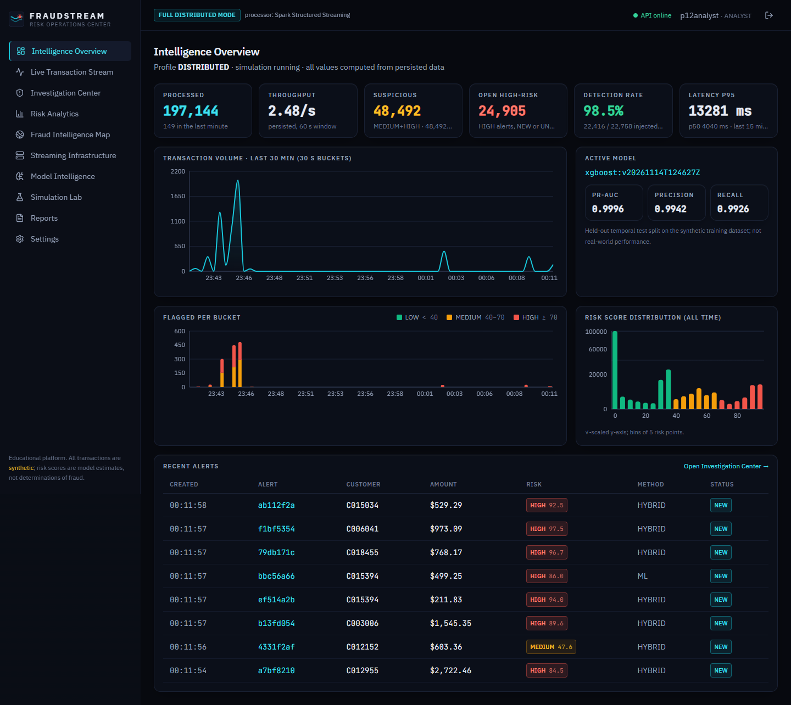

**Expect:** processed count, throughput (persisted, 60 s window), MEDIUM+HIGH count, open HIGH alerts, detection rate
against injected scenarios, p95 latency over the last 15 minutes, transaction-volume and flagged-per-bucket charts,
risk-score distribution, active model (`xgboost:v20261114T124627Z`, test PR-AUC 0.9996) with the note *"held-out
temporal test split on the synthetic training dataset; not real-world performance"*, and recent alerts.

## 4. Generate transactions (1 min)

Open **Simulation Lab**:

- **Traffic generator:** mode `mixed`, 10 tps, 120 s duration → Start. The run status shows events generated.
- **Inject a suspicious scenario:** choose `account_takeover` → Inject.

**Point out:** in this profile the API **produces to Kafka**. If Kafka were down, the button would return 503 rather
than silently scoring in-process.

## 5. Live streaming (1 min)

Open **Live Transaction Stream**.

**Expect:** rows appearing within ~3 s of generation (measured p50 ≈ 2.5 s at 10 ev/s), each with risk score,
category and detection method. The injected `account_takeover` events appear as HIGH.

Then open **Streaming Infrastructure** 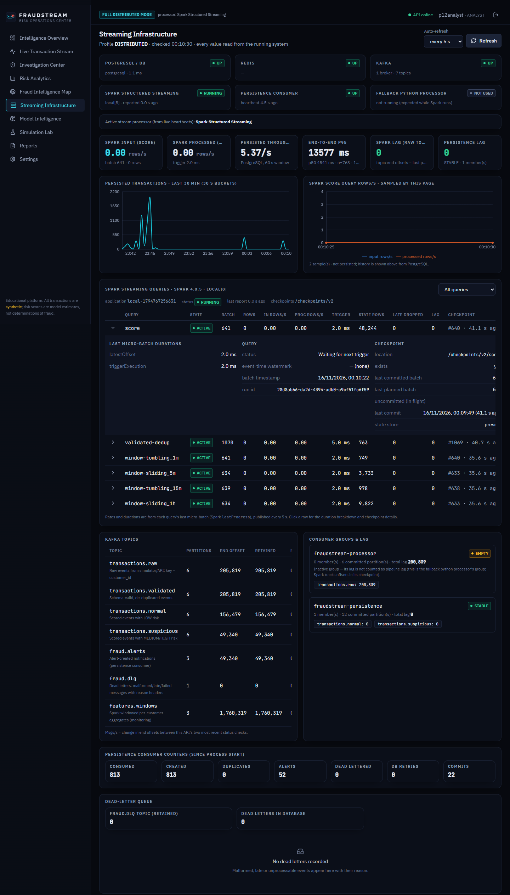:

- PostgreSQL, Redis, Kafka, Spark, consumer all UP; fallback processor "not running (expected while Spark runs)".
- Spark query table: `score`, `validated-dedup` and four window queries, each ACTIVE with its batch id, rows/s,
  state rows and **last committed checkpoint batch**. Expand `score` to show the duration breakdown and checkpoint.
- Kafka topics with end offsets; consumer group `fraudstream-persistence` lag ≈ 0; DLQ empty.

## 6. Fraud alerts (1 min)

Open **Investigation Center**. Filter to HIGH and `NEW`.

**Point out:** alerts exist only for MEDIUM and HIGH. Filters and sorting are applied on the server. Export CSV is
formula-injection safe.

## 7. Investigate an alert (2–3 min)

Open one of the injected `account_takeover` alerts 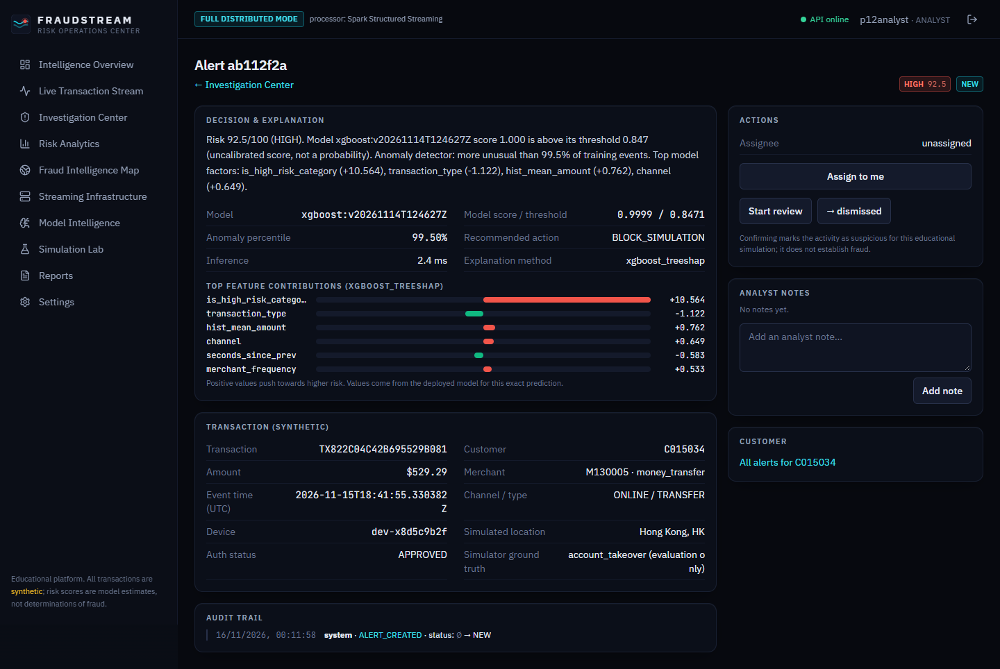.

**Expect:** a *Decision & explanation* panel: risk score and category; a plain-language explanation naming the
model score against its threshold ("uncalibrated score, not a probability"), the anomaly percentile, and any triggered
rules; the recommended action (`BLOCK_SIMULATION` for HIGH) and the measured inference time. Below it, the **top
feature contributions** (XGBoost TreeSHAP) and the synthetic transaction, including the simulator ground truth marked
"evaluation only". Then the alert's audit trail (`ALERT_CREATED` by `system`), notes, the assign/review actions, and a
link to all alerts of the customer.

Then:

1. Click **Start review** (status → UNDER_REVIEW) and add a note.
2. Go back to the **Investigation Center** (alerts tab). Tick this alert and the other alerts of the same customer, type
   an investigation title and click **Open investigation**. Investigations group the alerts of a single customer.
3. In the investigation: **IN_PROGRESS** → **RESOLVED** with final classification `CONFIRMED_SUSPICIOUS` and findings
   (≥ 10 characters) → **CLOSED** 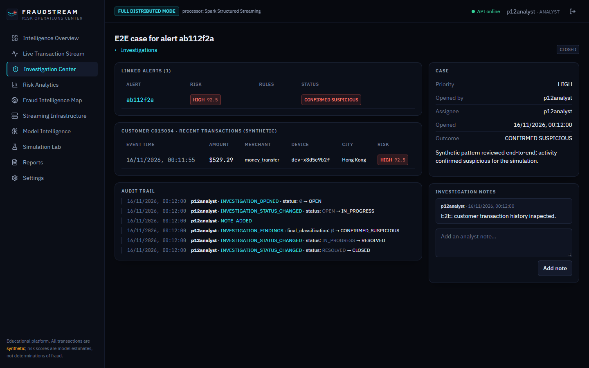.

**Point out:** every step is a server-side state machine (an illegal transition returns 409) and is audited.
Analysts can act only on unassigned items or items assigned to them.

## 8. Model Intelligence (1–2 min)

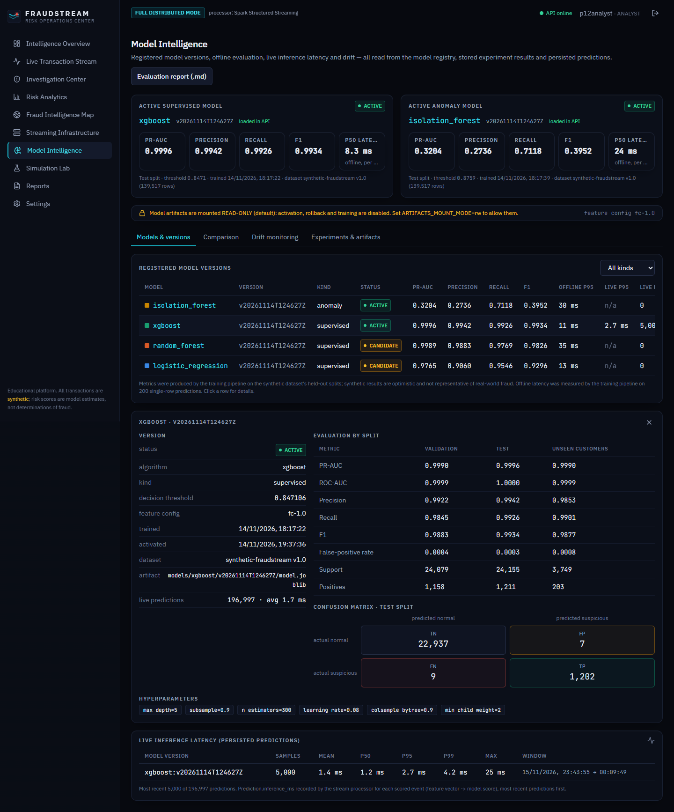

- **Registry:** four versions with validation and test metrics; offline vs **live** inference latency. *Activate* is
  disabled with "Artifacts are mounted read-only". That is deliberate.
- **Comparison:** switch between the temporal test and the unseen-customer split. The selection rule is stated:
  highest **validation** PR-AUC, test set never used.
- **Drift:** click **Run drift check now**. Expect a **SIGNIFICANT** result (e.g. `hour_of_day`). Explain that live
  simulator traffic is stamped near "now" while the training data covers one simulated day. PSI measures input drift,
  not concept drift. The labelled live precision/recall sit next to the test values.

Note: the drift check stores a drift report in the database (normal behaviour of the endpoint).

## 9. Risk Analytics (1 min)

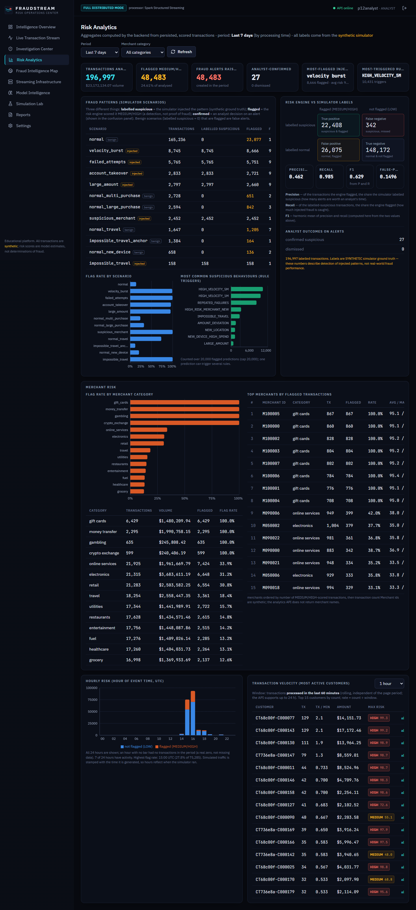

Set the period to **last 1 hour**.

**Expect:** per-scenario table separating **labelled suspicious** (simulator truth), **flagged** (risk engine) and
analyst-confirmed; the confusion matrix of the risk engine against simulator labels, with a SYNTHETIC-labels warning;
merchant categories; hourly distribution (UTC event time); velocity leaders.

**Point out:** every filter changes the server query and is kept in the URL.

## 10. Fraud Intelligence Map (1 min)

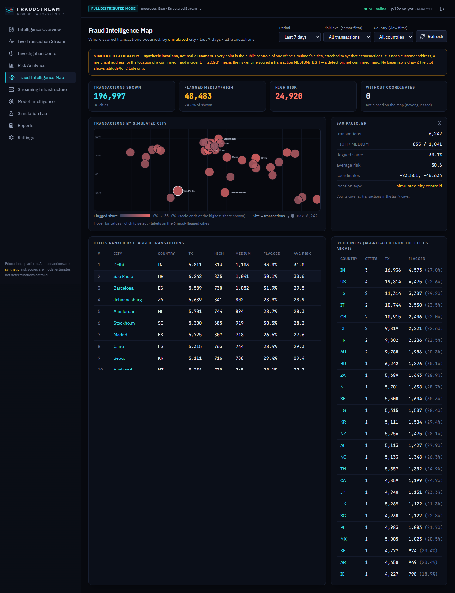

**Expect:** a latitude/longitude plot of up to 38 simulated city centroids, with bubble size = transactions and colour
= flagged share. Hover any city for its numbers; there are city and country tables.

**Point out the disclaimer:** these are public city centroids, not addresses, and "flagged" means a detection, not
confirmed fraud. No basemap is drawn and no external tiles are loaded.

## 11. Generate a report (1 min)

Open **Reports** 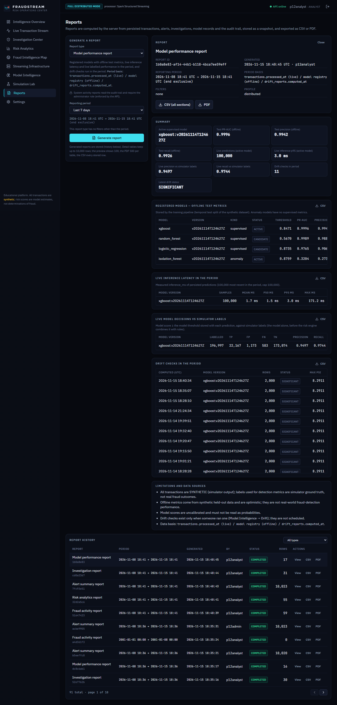:

- Type **Alert summary**, period **Last 7 days**, optional status filter → **Generate report**.
- **Expect:** metadata (id, generator, exact `start → end (end exclusive)` UTC period), summary tiles, breakdown
  tables, limitations and data sources.
- Download the **PDF** and one section as **CSV**. The report is stored as a snapshot and listed in the history.

As an analyst, the *System activity* type is unavailable (admin only).

## 12. Settings and the audit trail (2 min)

Log out and log in as the **admin**. Open **Settings**:

- **Risk rules** 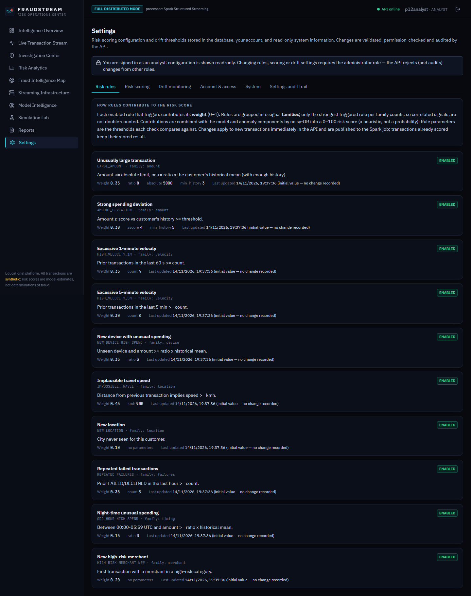: edit a rule weight → the confirmation dialog
  lists exactly `field: old → new` with focus on **Cancel** 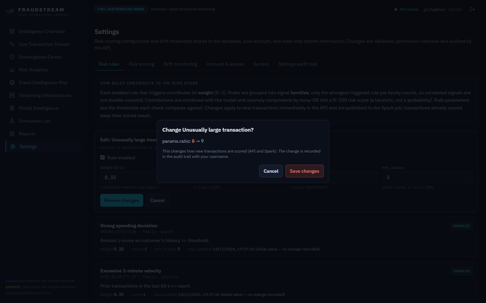.
  **Cancel it**, so the live risk configuration stays unchanged.
- **Drift monitoring:** change `min_rows` (e.g. 200 → 201) and confirm. The page shows the saved value. Change it back
  to **200** afterwards.
- **System:** read-only profile, processor, services, active models, `read-only (activation disabled)`.
- **Settings audit trail** 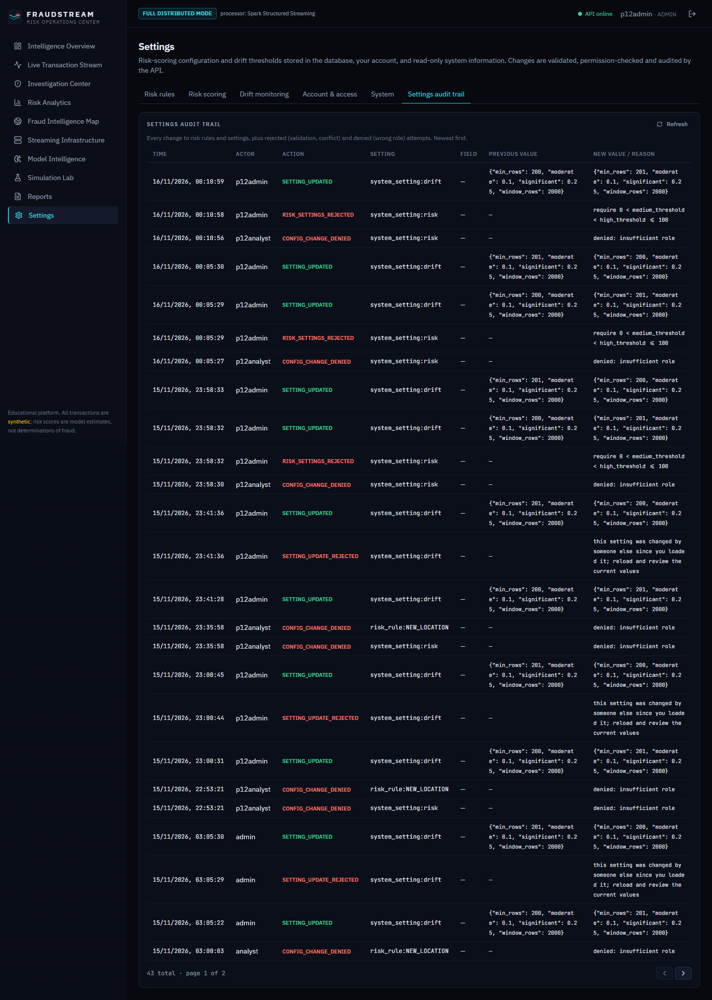: both drift changes appear with
  old and new values, alongside any rejected or denied attempts.

**Point out:** every update must carry the `expected_updated_at` version the page loaded. A concurrent change returns
409, and a request without a version returns 428. An analyst sees the same page read-only, and the API returns 403
and audits the attempt.

**Optional (30 s):** show a phone layout (browser dev tools, 390 px). Every page works without horizontal scrolling
([mobile screenshots](screenshots/README.md#mobile-390-px)).

**Closing line:** "Measured on this laptop: about 100 events per second sustained, ~3 s end-to-end at normal load,
zero lost or duplicate rows through Kafka, Spark, PostgreSQL and Redis outages, and a tested backup and restore. The
limits are documented: single host, no TLS, synthetic data."

## If the demo fails

| Symptom | Quick recovery |
|---|---|
| Header shows `processor: NOT RUNNING` | `docker compose --env-file .env --profile distributed start spark`; wait for `(healthy)` (≤ 2 min). Events produced meanwhile wait in Kafka and are processed once. |
| Header shows `UNKNOWN (Redis unavailable)` | `... start redis`. Persistence continues meanwhile; the live feed resumes in ~20 s. |
| Simulation Lab returns 503 "Kafka unavailable" | `... start kafka`; retry after ~30 s. |
| Login returns "Too many attempts" | 10 logins/min limit: wait 60 s. |
| Live Stream empty but Overview counts grow | reload the page (the SSE connection reconnects); check Streaming Infrastructure for consumer lag. |
| A page shows errors / 502 | `docker compose ... ps`; `docker compose ... logs --tail 100 api`; `... restart api` (nginx follows the new container automatically). |
| Everything is down | `docker compose --env-file .env --profile distributed up -d`: healthy in ~25–45 s. Data is kept in volumes. |
| No time to recover | switch to the screenshots in [docs/screenshots](screenshots/README.md), which cover every step above. |

Fallback for a laptop without enough memory for Spark: the **local profile**
(`docker compose --env-file .env --profile local up -d api-local frontend-local`, http://127.0.0.1:8081) shows every
page with the same scoring code running in-process. Say clearly that Kafka and Spark are not running in that profile;
the dashboard header shows it too.

## After the demo

- Confirm the drift `min_rows` is back at its original value, in Settings → Drift monitoring and in the audit trail.
- The demo added synthetic transactions, alerts, one investigation, a report and a drift report to the database. That
  is normal application data; there is no need to delete it.
- `docker compose --env-file .env --profile distributed stop` to free memory. **Not** `down -v`.
