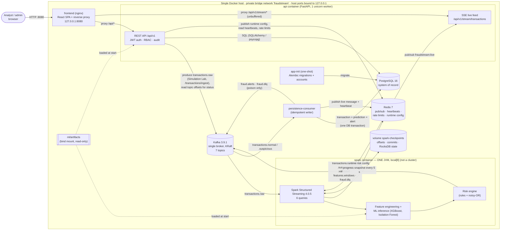
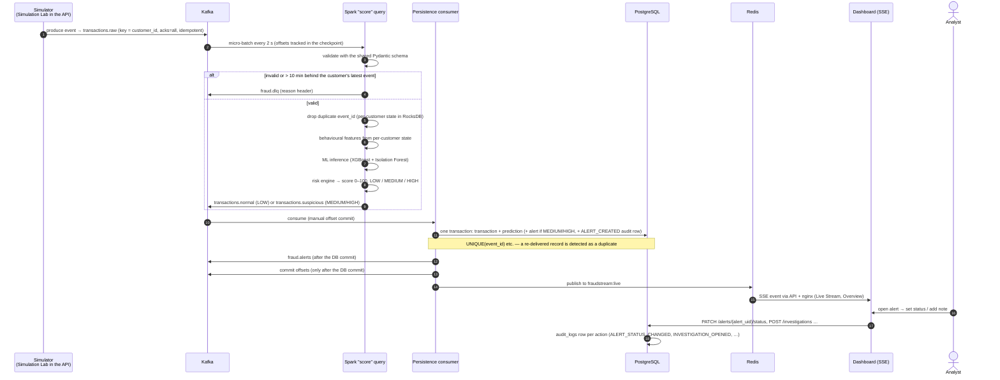
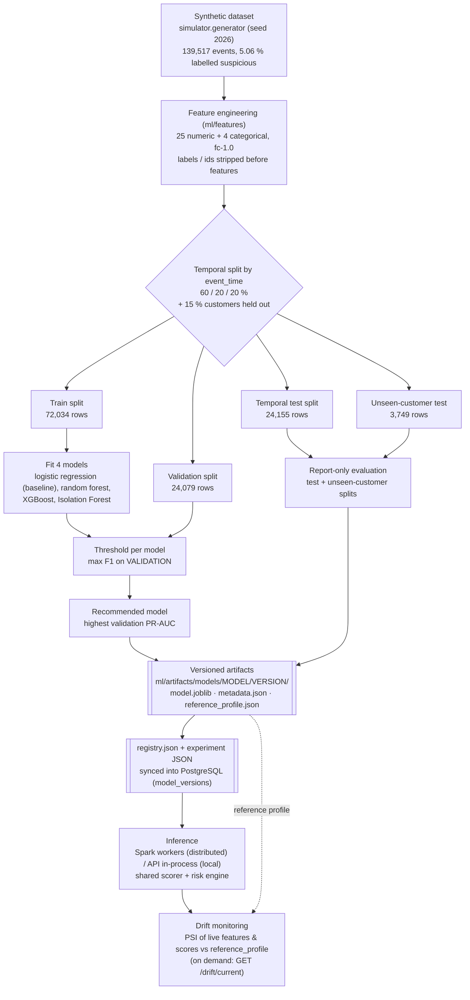
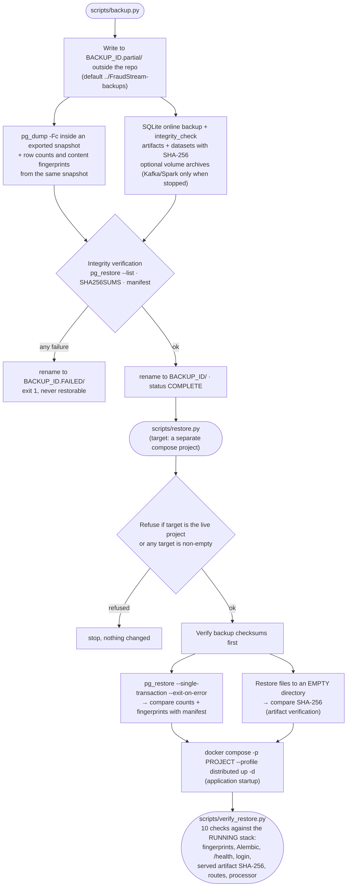

# FraudStream — Architecture diagrams

All diagrams are [Mermaid](https://mermaid.js.org/) and render on GitHub. Each one shows only components and
connections that exist in the code and in `docker-compose.yml`. Where a diagram simplifies something, the text
below it says what was left out.

- [A. System architecture (distributed profile)](#a-system-architecture-distributed-profile)
- [B. Transaction lifecycle](#b-transaction-lifecycle)
- [C. ML lifecycle](#c-ml-lifecycle)
- [D. Failure recovery](#d-failure-recovery)
- [E. Backup and restore](#e-backup-and-restore)

---

## A. System architecture (distributed profile)

Notes
- The API container is **not published** on the host; nginx is the only HTTP entry point.
- The **local profile** (`--profile local`) replaces everything right of nginx with one `api-local` container that
  runs the same feature/ML/risk code **in-process** on SQLite (no Kafka, Spark, Redis or PostgreSQL).
- Not drawn: the optional `python-processor` fallback (profile `python-processor`, never started by `distributed`,
  refuses to run while Spark reports), the one-shot `kafka-init` topic creator, and the Spark UI (127.0.0.1:4040).

---

## B. Transaction lifecycle

Notes
- In parallel, the `validated-dedup` query writes schema-valid, watermark-deduplicated events to
  `transactions.validated`, and four window queries write per-customer aggregates to `features.windows`
  (monitoring outputs; the persistence consumer does not read them).
- `POST /transactions/ingest` takes the same path as the simulator from step 1.

---

## C. ML lifecycle

The test splits are never used to choose a model or a threshold. Details and limitations:
[DATA_AND_ML.md](DATA_AND_ML.md).

---

## D. Failure recovery

Behaviour verified by the container test suite (`infrastructure/tests/test_container_stack.py`) and the Phase 12
failure tests on an isolated stack. Times are measured on one development machine.

```mermaid
flowchart TD
    subgraph kafkaF["Kafka broker stopped"]
        k1["Simulation Lab / ingest → HTTP 503 naming Kafka<br/>(no fallback to in-process scoring)"]
        k2["Producers buffer. Records not acknowledged<br/>within 30 s are reported failed, never persisted"]
        k3["Broker restarts → Spark + consumer resume,<br/>every acknowledged event persisted exactly once<br/>(lag 0 after 49–56 s)"]
        k1 --> k2 --> k3
    end
    subgraph sparkF["Spark crash or stop"]
        s1["restart: unless-stopped (crash)<br/>or manual start"]
        s2["Resume from checkpoint<br/>(offsets + RocksDB state)"]
        s3["Backlog of 3,000 drained in 53–78 s,<br/>no duplicates. Graceful stop shows NOT RUNNING"]
        s1 --> s2 --> s3
    end
    subgraph pgF["PostgreSQL stopped"]
        p1["API /health → 503 database=down"]
        p2["Consumer blocks + retries with backoff,<br/>offsets NOT committed, stays healthy"]
        p3["DB back → all events produced<br/>during the outage persisted once"]
        p1 --> p2 --> p3
    end
    subgraph redisF["Redis stopped"]
        r1["Circuit breaker fails fast<br/>(no +4 s per request)"]
        r2["Persistence continues. Live feed and<br/>processor status UNKNOWN, login uses<br/>in-process rate limiter"]
        r3["Spark keeps last Redis risk config.<br/>Redis back → feed recovers in 16–21 s"]
        r1 --> r2 --> r3
    end
    subgraph fullF["Full stack stop + up -d"]
        f1["Named volumes keep DB, Kafka log,<br/>checkpoints. Artifacts are a bind mount"]
        f2["All 7 services healthy in 22–45 s"]
        f3["First new event persisted and on<br/>the live feed after 41–77 s"]
        f1 --> f2 --> f3
    end
```

A Spark crash shorter than the 30 s heartbeat window may never appear as NOT RUNNING on the dashboard because Docker
restarts the job before the status goes stale. Procedures: [OPERATIONS.md](OPERATIONS.md#5-failure-recovery).

---

## E. Backup and restore

Measured: live → isolated restore healthy in 48 s, final cycle healthy in 43 s, `verify_restore.py` 10/10 both times.
Full procedure: [OPERATIONS.md](OPERATIONS.md#6-backup-and-restore) and
[phase12/BACKUP_AND_RESTORE.md](phase12/BACKUP_AND_RESTORE.md).
