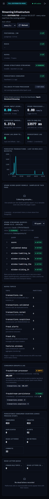
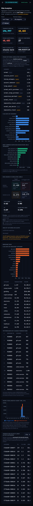
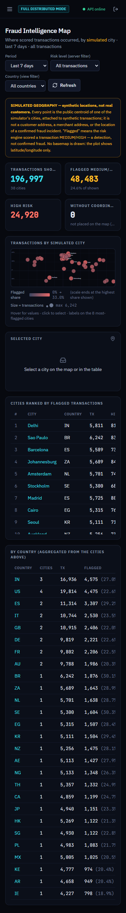
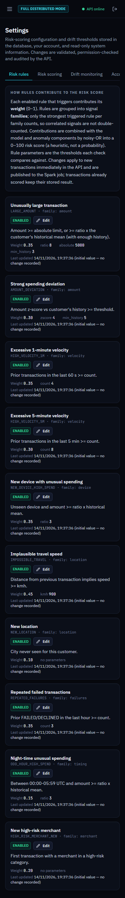

# Screenshots

Real screenshots of the running application. None were edited.

**Provenance.** All files here are unmodified copies of screenshots taken by the Playwright E2E suite
(`frontend/e2e/*.spec.ts`) during the final Phase 12 run, on 2026-11-16, against the **distributed profile** of the
isolated test stack (compose project `fraudstream-p12`, dashboard on port 18080). That stack had just been through
the load benchmarks and failure tests, so:

- volumes are large (~197k transactions) and the flagged share is high (~25 %), because one benchmark deliberately
  produced an alert storm;
- the 15-minute latency tiles (p95 ≈ 13 s) include events delayed by the simulated outages. Steady-state p95 at normal
  load is ≈ 3.5 s;
- the user names are the isolated stack's test accounts (`p12admin`, `p12analyst`) and the environment shows `test`.

The originals, including the local-profile set, remain in `frontend/e2e-results/screenshots/` (gitignored, so they are
regenerated by every E2E run).

## Desktop (1440 px)

| Page | File |
|---|---|
| Intelligence Overview | [01-intelligence-overview.png](desktop/01-intelligence-overview.png) |
| Live Transaction Stream | [02-live-stream.png](desktop/02-live-stream.png) |
| Simulation Lab | [03-simulation-lab.png](desktop/03-simulation-lab.png) |
| Alert detail (explanation, rules, contributions) | [04-alert-detail.png](desktop/04-alert-detail.png) |
| Investigation, closed | [05-investigation-closed.png](desktop/05-investigation-closed.png) |
| Streaming Infrastructure | [06-streaming-infrastructure.png](desktop/06-streaming-infrastructure.png) |
| Model Intelligence — registry | [07-model-intelligence-registry.png](desktop/07-model-intelligence-registry.png) |
| Model Intelligence — comparison | [08-model-intelligence-compare.png](desktop/08-model-intelligence-compare.png) |
| Model Intelligence — drift | [09-model-intelligence-drift.png](desktop/09-model-intelligence-drift.png) |
| Risk Analytics | [10-risk-analytics.png](desktop/10-risk-analytics.png) |
| Fraud Intelligence Map | [11-fraud-intelligence-map.png](desktop/11-fraud-intelligence-map.png) |
| Reports | [12-reports.png](desktop/12-reports.png) |
| Settings — risk rules | [13-settings-risk-rules.png](desktop/13-settings-risk-rules.png) |
| Settings — rule change confirmation | [14-settings-rule-confirm.png](desktop/14-settings-rule-confirm.png) |
| Settings — system (analyst, read-only) | [15-settings-system.png](desktop/15-settings-system.png) |
| Settings — audit trail | [16-settings-audit-trail.png](desktop/16-settings-audit-trail.png) |

## Mobile (390 px)

| Page | File |
|---|---|
| Streaming Infrastructure | [streaming-mobile.png](mobile/streaming-mobile.png) |
| Model Intelligence | [models-mobile.png](mobile/models-mobile.png) |
| Risk Analytics | [risk-analytics-mobile.png](mobile/risk-analytics-mobile.png) |
| Fraud Intelligence Map | [fraud-map-mobile.png](mobile/fraud-map-mobile.png) |
| Reports | [reports-mobile.png](mobile/reports-mobile.png) |
| Settings | [settings-mobile.png](mobile/settings-mobile.png) |
| Confirmation dialog | [confirm-dialog-mobile.png](mobile/confirm-dialog-mobile.png) |

Not included: the five unprefixed Phase 7 screenshots and the two Phase 10 recovery screenshots in
`frontend/e2e-results/screenshots/`, which show an older UI.
